<div align="center">

# ΧΑΡΟΚΟΠΕΙΟ ΠΑΝΕΠΙΣΤΗΜΙΟ
## Τμήμα Πληροφορικής και Τηλεματικής

<br>

### DIT266 — Υπολογιστικό Νέφος (Cloud Computing)

<br>

## Διαχείριση OpenStack Tenant ως Cloud Administrator

<br><br>

**Αναστασία Ζέρβας**


</div>

<div style="page-break-after: always;"></div>

## 1. Εισαγωγή

Η παρούσα εργασία υλοποιεί τον πλήρη κύκλο διαχείρισης ενός **OpenStack tenant** από τον ρόλο του **Cloud Administrator**. Στόχος ήταν, ξεκινώντας από ένα «καθαρό» περιβάλλον OpenStack, να στηθεί ένα απομονωμένο project με δικούς του χρήστες, ποσοστώσεις πόρων, δικτύωση, κανόνες ασφαλείας και εικονικές μηχανές, και τελικά να επαληθευτεί η ορθή λειτουργία του με πραγματικό φόρτο εργασίας.

Το τελικό αποτέλεσμα είναι μια **αρχιτεκτονική δύο επιπέδων (2-tier)** μέσα στο tenant:

| Πόρος | Ρόλος στο σενάριο |
|---|---|
| `BrickProject` | Το project (tenant) της εταιρείας |
| `BrickAdmin` | Ο διαχειριστής-χρήστης του project |
| `BrickNet` / `BrickSubnet` | Το ιδιωτικό δίκτυο 192.168.100.0/24 |
| `BrickRouter` | Δρομολογητής προς το εξωτερικό δίκτυο `public` |
| `BrickSG` | Ομάδα ασφαλείας (SSH, HTTP, ICMP) |
| `BrickVM-Postgres` (lab.medium) | VM βάσης δεδομένων — PostgreSQL |
| `BrickVM-Flask` (lab.small) | VM εφαρμογής — Flask REST API |

<div style="page-break-after: always;"></div>

## 2. Προετοιμασία Περιβάλλοντος (DevStack σε GCP)

Πριν από οποιαδήποτε ενέργεια διαχείρισης, στήθηκε το ίδιο το περιβάλλον OpenStack. Δημιουργήθηκε εικονική μηχανή στο **Google Cloud Compute Engine** (Ubuntu 24.04, εσωτερική IP `10.132.0.2`) και εγκαταστάθηκε το **DevStack** (all-in-one).

Τα βασικά βήματα της προετοιμασίας ήταν:

- Δημιουργία της VM στο GCP και ζεύγους κλειδιών SSH για απομακρυσμένη πρόσβαση.
- Δημιουργία χρήστη `stack`, λήψη του DevStack (`git clone https://opendev.org/openstack/devstack`) και σύνταξη του `local.conf` (ορισμός `HOST_IP`, passwords, ενεργοποίηση υπηρεσιών — μεταξύ αυτών και του Swift για object storage).
- Εκτέλεση `./stack.sh` για την εγκατάσταση όλων των υπηρεσιών (Keystone, Nova, Neutron, Glance, Cinder, Horizon).
- Δημιουργία **systemd service** για αυτόματη επανεκκίνηση (rejoin) του DevStack μετά από reboot.
- Πρόσβαση στο Horizon από τον τοπικό υπολογιστή μέσω SSH tunnel:

```bash
ssh -i ~/.ssh/devstack_key -L 8080:10.132.0.2:80 <user>@<EXTERNAL_IP> -N
# Horizon: http://localhost:8080/dashboard
```

<div align="center">

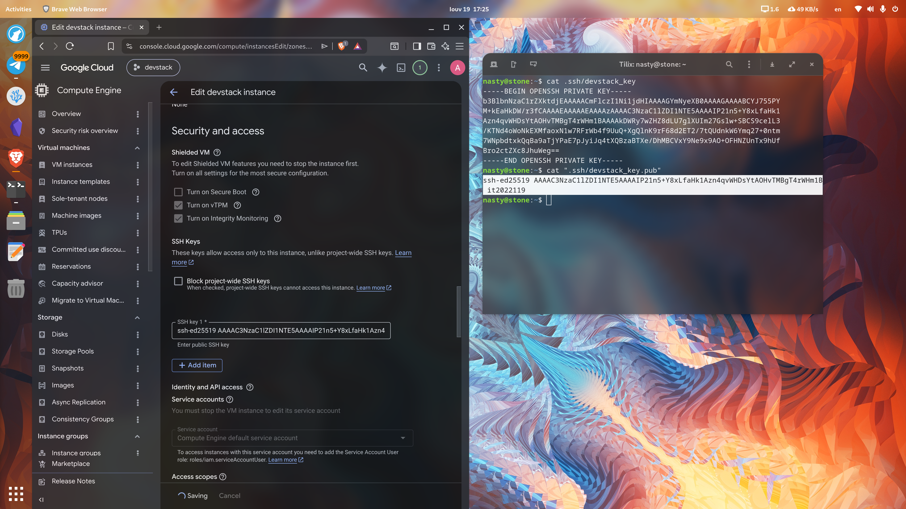

*Εικόνα 1 — Δημιουργία της VM στο Google Cloud Compute Engine.*

</div>

> **Οι εικόνες 1–17** τεκμηριώνουν αναλυτικά τη ροή της εγκατάστασης (δημιουργία VM στο GCP, κλειδιά SSH, λήψη DevStack, `local.conf`, εκτέλεση `stack.sh`, πρώτη είσοδος στο Horizon, ρύθμιση systemd service, κανόνες iptables/NAT, και upload της εικόνας `debian-12-cloud`). Παρατίθενται παρακάτω ως τεκμήριο της προετοιμασίας.

<div align="center">

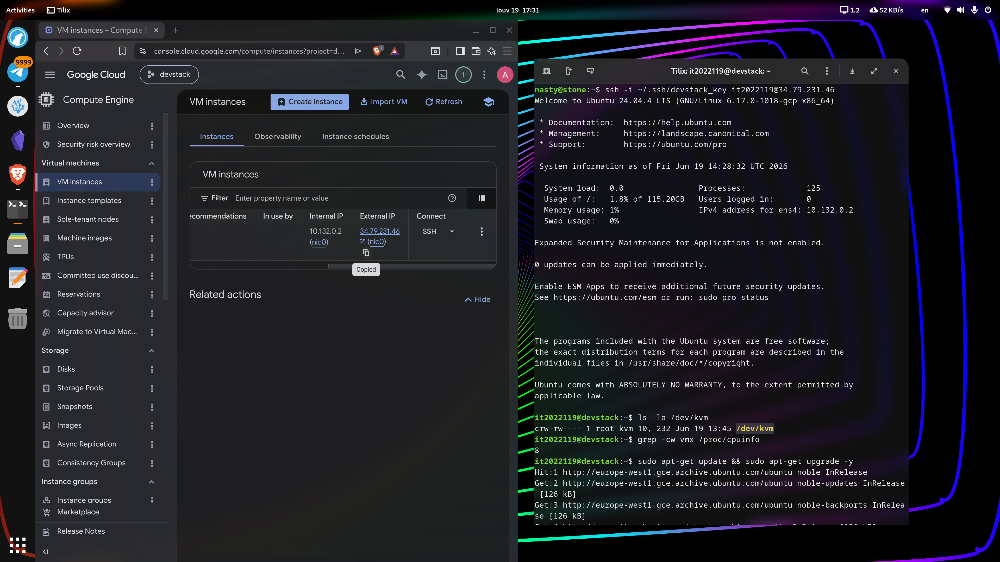

*Εικόνα 2 — Σύνδεση στη VM με `ssh -i ~/.ssh/devstack_key` και έλεγχος καταλληλότητας για virtualization: `ls -la /dev/kvm` (ύπαρξη συσκευής KVM) και `grep -cw vmx /proc/cpuinfo` (επιστρέφει 8 → υποστήριξη Intel VT-x στους πυρήνες). Ακολουθεί `sudo apt-get update && sudo apt-get upgrade -y` για ενημέρωση του συστήματος.*

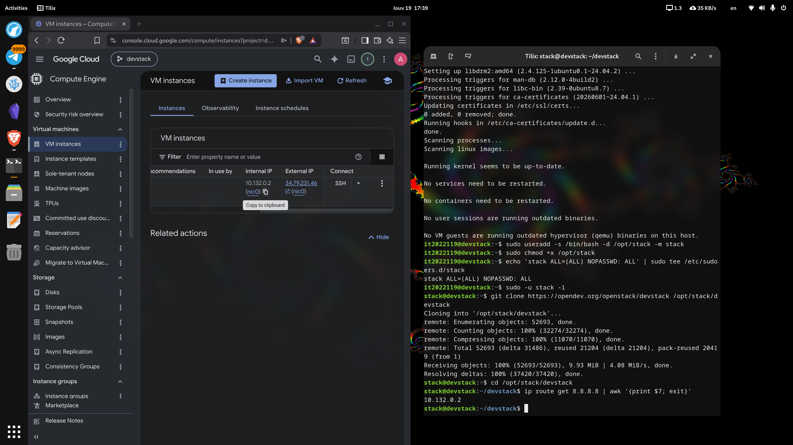

*Εικόνα 3 — Προετοιμασία του χρήστη `stack`: `useradd -s /bin/bash -d /opt/stack -m stack`, δικαιώματα NOPASSWD μέσω `/etc/sudoers.d/stack` και είσοδος με `sudo -u stack -i`. Στη συνέχεια `git clone https://opendev.org/openstack/devstack /opt/stack/devstack` (λήψη του DevStack) και `ip route get 8.8.8.8` για εξακρίβωση της εσωτερικής IP (10.132.0.2).*

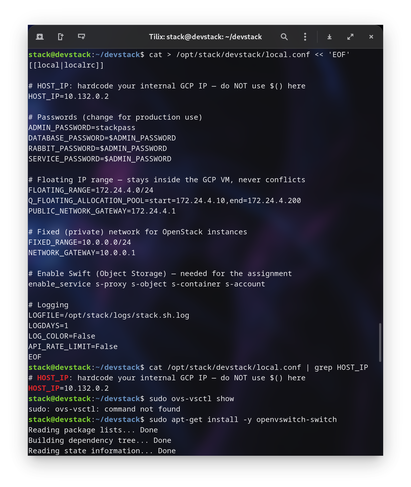

*Εικόνα 4 — Δημιουργία του αρχείου ρυθμίσεων `local.conf` με heredoc: ορισμός `HOST_IP`, κωδικών (`ADMIN/DATABASE/RABBIT/SERVICE_PASSWORD`), εύρους floating IP (`FLOATING_RANGE=172.24.4.0/24`), ιδιωτικού δικτύου (`FIXED_RANGE`), ενεργοποίηση Swift και ρυθμίσεις logging. Επαλήθευση με `grep HOST_IP` και εγκατάσταση του `openvswitch-switch`.*

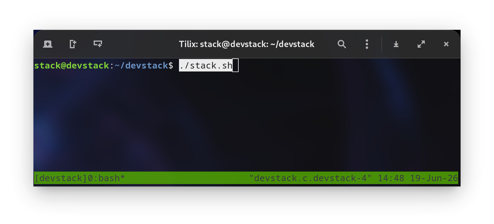

*Εικόνα 5 — Εκκίνηση της εγκατάστασης με `./stack.sh` (ο χρήστης `stack` εκτελεί το script που στήνει όλες τις υπηρεσίες του OpenStack μέσα σε tmux session).*

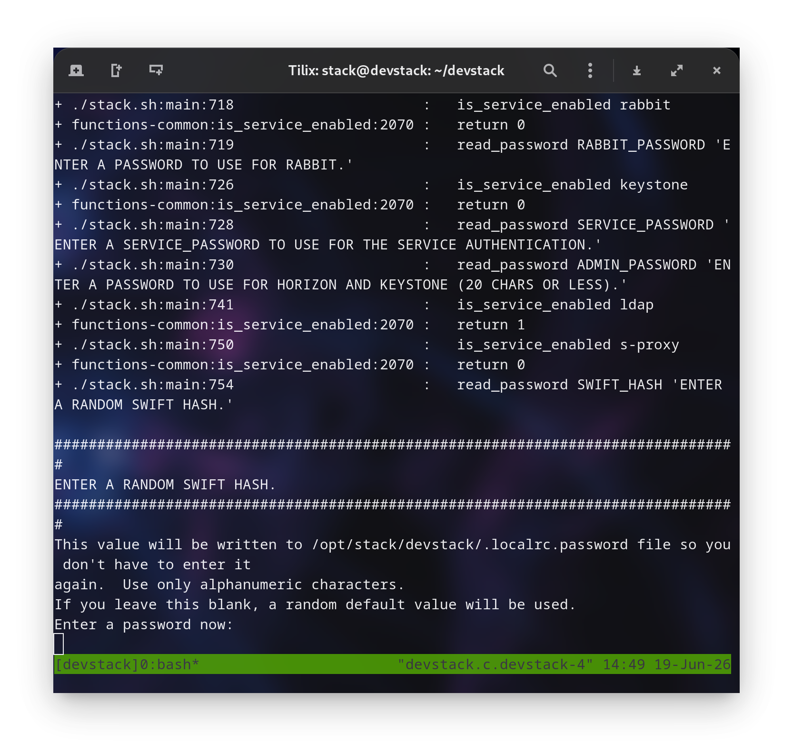

*Εικόνα 6 — Πρόοδος του `stack.sh`: το script ελέγχει ποιες υπηρεσίες είναι ενεργές (`is_service_enabled`) και διαβάζει/ορίζει τους κωδικούς (RABBIT, SERVICE, ADMIN, SWIFT_HASH) που αποθηκεύονται στο `.localrc.password`.*

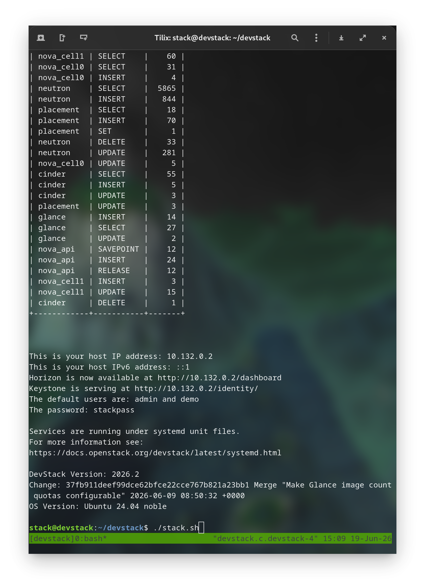

*Εικόνα 7 — Επιτυχής ολοκλήρωση του `stack.sh`. Εμφανίζεται η διεύθυνση του Horizon (`http://10.132.0.2/dashboard`) και του Keystone (`/identity`), οι προεπιλεγμένοι χρήστες (admin/demo), ο κωδικός (`stackpass`) και η έκδοση DevStack 2026.2.*

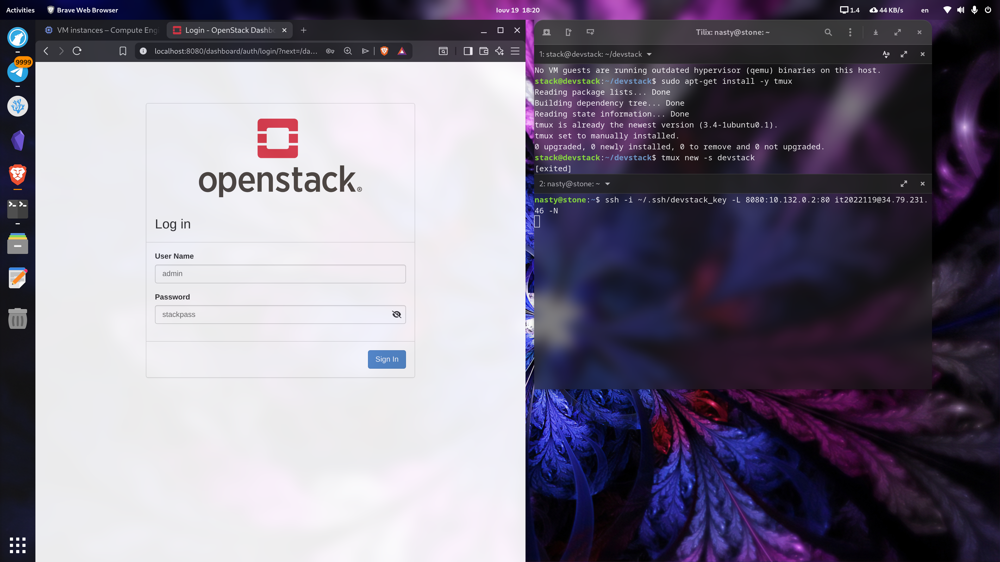

*Εικόνα 8 — Δημιουργία SSH tunnel από τον τοπικό υπολογιστή (`ssh -L 8080:10.132.0.2:80`) ώστε το Horizon να είναι προσβάσιμο στο `localhost:8080`, και πρώτη είσοδος στο dashboard με τον χρήστη `admin`.*

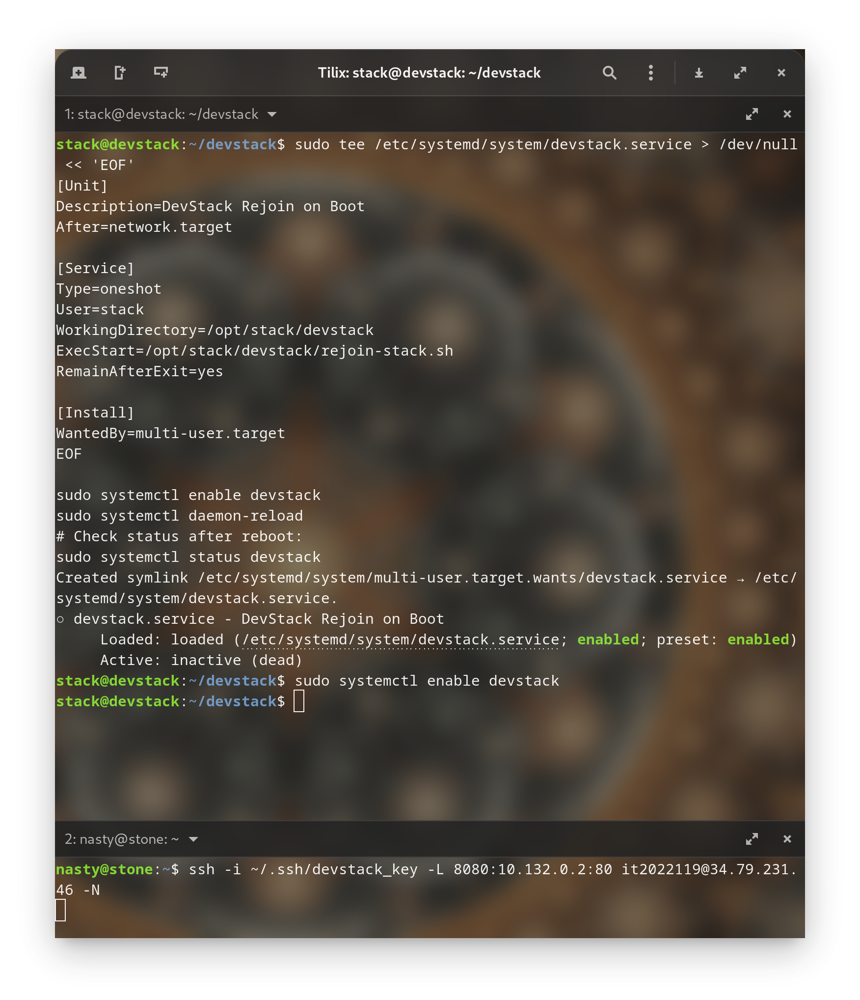

*Εικόνα 9 — Δημιουργία systemd service (`devstack.service`) που εκτελεί το `rejoin-stack.sh` ώστε οι υπηρεσίες να επανέρχονται αυτόματα μετά από reboot, και ενεργοποίησή του με `systemctl enable devstack`.*

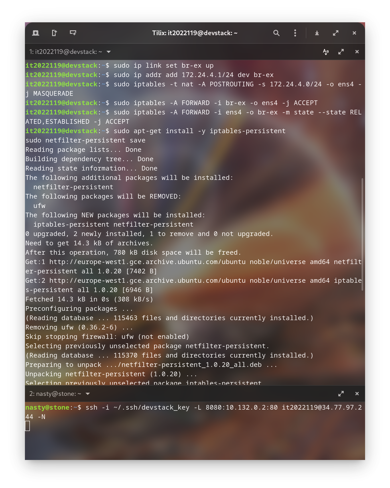

*Εικόνα 10 — Ρύθμιση δικτύωσης για εξωτερική πρόσβαση των instances: ενεργοποίηση της γέφυρας `br-ex`, ανάθεση της gateway IP (`172.24.4.1/24`) και κανόνες iptables NAT — `MASQUERADE` για το floating range και `FORWARD` rules ώστε η κίνηση να δρομολογείται προς το `ens4`. Με `iptables-persistent` οι κανόνες διατηρούνται μετά από reboot.*

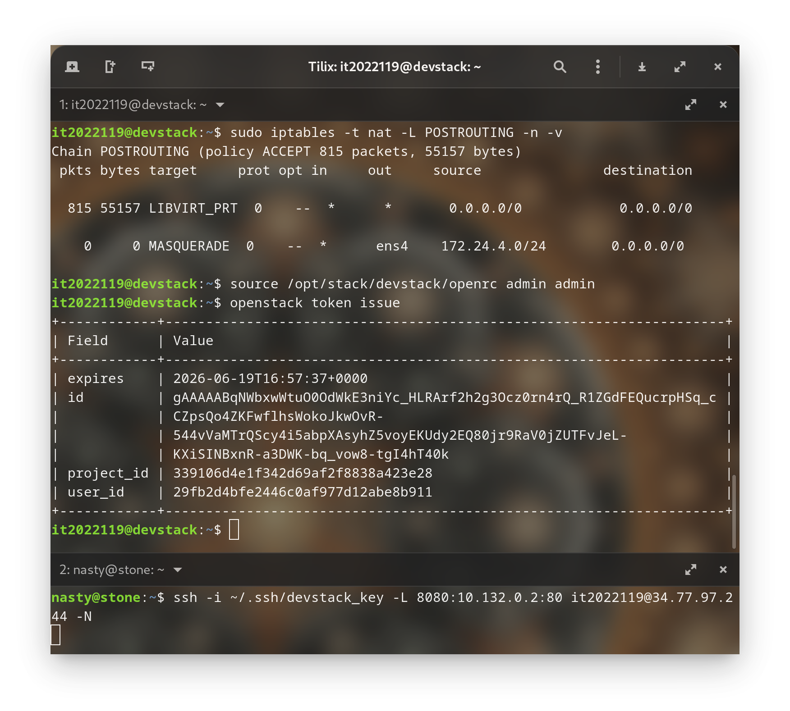

*Εικόνα 11 — Επαλήθευση του NAT κανόνα με `iptables -t nat -L POSTROUTING` (φαίνεται το MASQUERADE για 172.24.4.0/24). Στη συνέχεια φόρτωση των credentials με `source openrc admin admin` και έλεγχος ότι το Keystone αποκρίνεται με `openstack token issue` (επιστρέφεται έγκυρο token).*

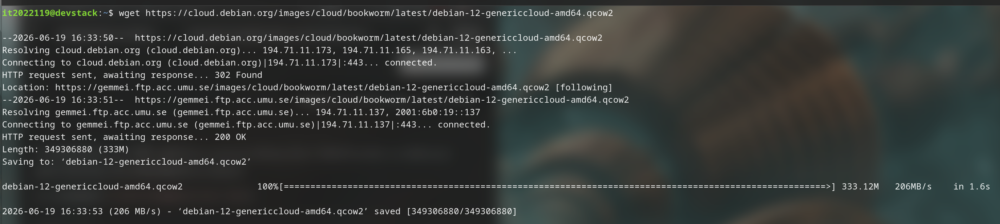

*Εικόνα 12 — Λήψη της επίσημης cloud εικόνας του Debian 12 με `wget` (`debian-12-genericcloud-amd64.qcow2`, ~333 MB) για να χρησιμοποιηθεί ως πρότυπο των VMs.*

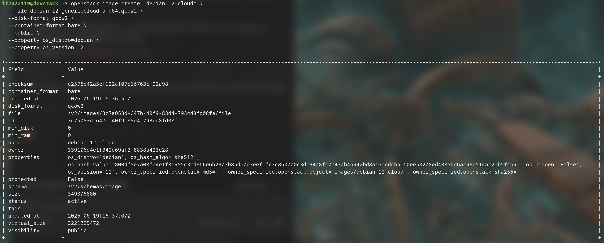

*Εικόνα 13 — Καταχώριση της εικόνας στο Glance με `openstack image create "debian-12-cloud"` (`--disk-format qcow2`, `--container-format bare`, `--public`, properties `os_distro/os_version`). Η εικόνα δημιουργείται με κατάσταση `active`.*

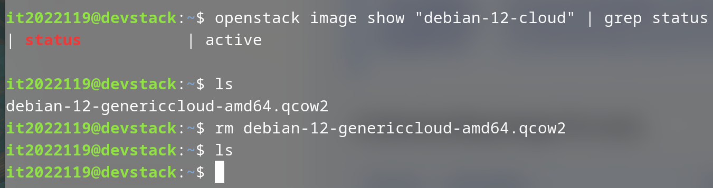

*Εικόνα 14 — Επιβεβαίωση ότι η εικόνα είναι `active` με `openstack image show ... | grep status` και διαγραφή του τοπικού `.qcow2` αρχείου (`rm`), αφού πλέον φυλάσσεται στο Glance.*

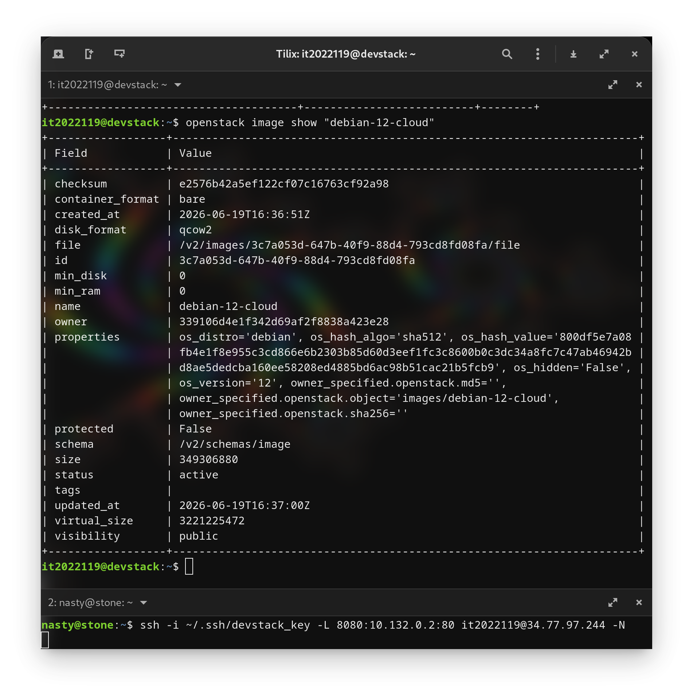

*Εικόνα 15 — Πλήρη μεταδεδομένα της εικόνας `debian-12-cloud` με `openstack image show` (checksum, id, μέγεθος, properties, visibility public).*

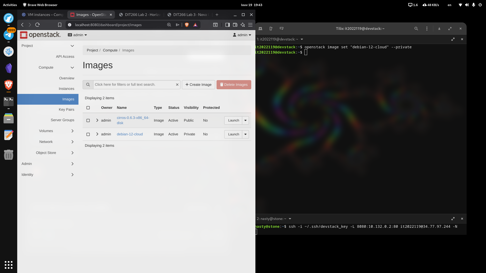

*Εικόνα 16 — Διαχείριση ορατότητας της εικόνας από CLI και Horizon: με `openstack image set "debian-12-cloud" --private` η εικόνα γίνεται Private (όπως φαίνεται στη λίστα Images του dashboard).*


*Εικόνα 17 — Επαναφορά της εικόνας σε δημόσια με `openstack image set "debian-12-cloud" --public`, ώστε να είναι διαθέσιμη ως πρότυπο για τα instances (visibility Public στη λίστα Images του Horizon). Ολοκλήρωση της προετοιμασίας του περιβάλλοντος.*

</div>

<div style="page-break-after: always;"></div>

## Ενότητα 1 — Διαχείριση Ταυτότητας & Flavors

**Στόχος:** Δημιουργία του project, του χρήστη-διαχειριστή και απόδοση ρόλου, καθώς και ορισμός των τύπων εικονικών μηχανών (flavors) που θα χρησιμοποιηθούν.

### 1 Δημιουργία Project

Πρώτο βήμα είναι η δημιουργία του project `BrickProject`, που αποτελεί το λογικά απομονωμένο tenant της εταιρείας:

```bash
openstack project create --description 'Brick' BrickProject
```

Επιστράφηκε το αναγνωριστικό `id = 1d93e9c384b04d2faa7056f760187c8d`, το οποίο εμφανίζεται σε όλους τους πόρους που ανήκουν στο project (βλ. π.χ. `project_id` σε δίκτυα/floating IPs παρακάτω).

<div align="center">

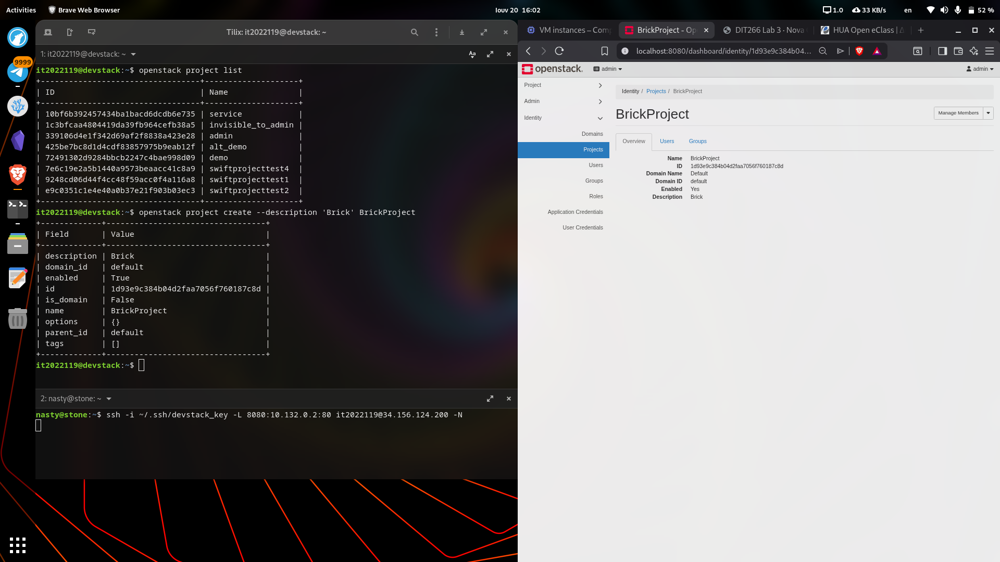

*Εικόνα 18 — Δημιουργία του `BrickProject` μέσω CLI.*

</div>

### 2 Δημιουργία Χρήστη

Στη συνέχεια δημιουργήθηκε ο χρήστης-διαχειριστής του project, `BrickAdmin`, με συνθηματικό:

```bash
openstack user create --password brickpass BrickAdmin
openstack user list
```

<div align="center">

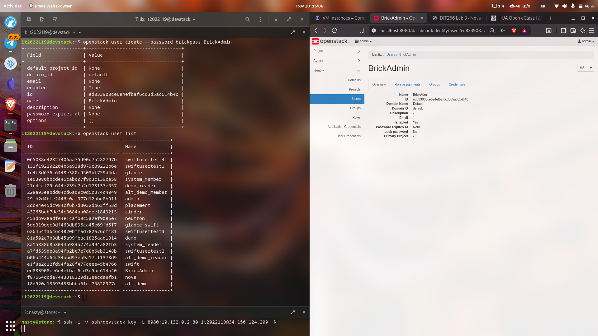

*Εικόνα 19 — Δημιουργία του χρήστη `BrickAdmin` και επιβεβαίωση με `user list`.*

</div>

### 3 Απόδοση Ρόλου

Για να μπορεί ο `BrickAdmin` να διαχειρίζεται τους πόρους του `BrickProject`, του αποδόθηκε ο ρόλος `member`:

```bash
openstack role add --project BrickProject --user BrickAdmin member
openstack role assignment list --names
openstack project show BrickProject
```

<div align="center">

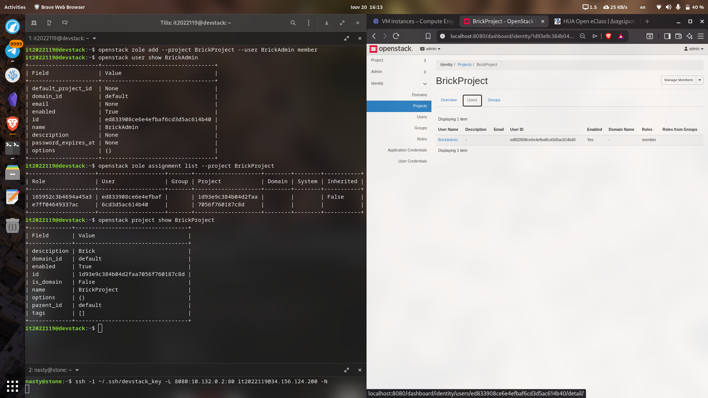

*Εικόνα 20 — Απόδοση ρόλου `member` στον `BrickAdmin` για το `BrickProject` και επαλήθευση.*

</div>

### 4 Δημιουργία Flavors

Ορίστηκαν δύο προσαρμοσμένοι τύποι μηχανών, ώστε να καλύπτουν δύο διαφορετικά προφίλ φόρτου του σεναρίου — έναν μεσαίο για τη βάση δεδομένων και έναν μικρότερο για την εφαρμογή:

```bash
openstack flavor create --vcpus 1 --ram 2048 --disk 10 lab.medium
openstack flavor create --vcpus 1 --ram 1024 --disk 10 lab.small
openstack flavor list
```

| Flavor | vCPUs | RAM | Disk | Χρήση |
|---|---|---|---|---|
| `lab.medium` | 1 | 2048 MB | 10 GB | VM βάσης (PostgreSQL) |
| `lab.small` | 1 | 1024 MB | 10 GB | VM εφαρμογής (Flask) |

<div align="center">

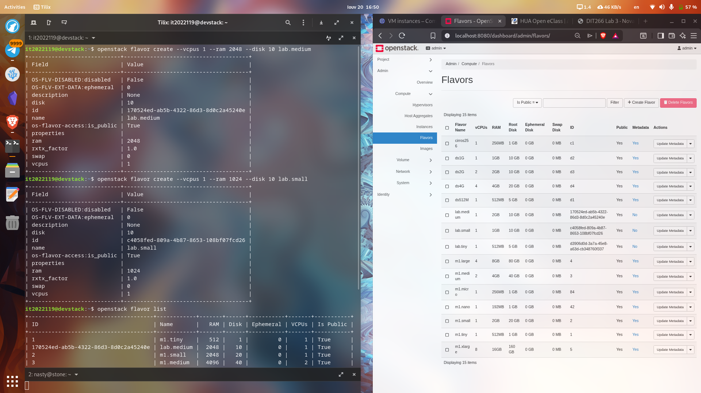

*Εικόνα 21 — Δημιουργία των flavors `lab.medium` και `lab.small` (CLI και προβολή στο Horizon).*

</div>

> **Σχόλιο:** Η δημιουργία flavors είναι ενέργεια καθαρά διαχειριστική (admin), γι' αυτό εκτελείται με τα διαπιστευτήρια του admin και όχι του `BrickAdmin`. Οι δύο διαφορετικοί τύποι επιλέχθηκαν σκόπιμα ώστε αργότερα να φανεί η αντιστοίχιση πόρων ανά ρόλο VM.

### 5 Αρχείο Πιστοποίησης (openrc) του χρήστη BrickAdmin

Για να εκτελούνται οι ενέργειες σε επίπεδο project με την ταυτότητα του `BrickAdmin` (και όχι του admin), δημιουργήθηκε ένα αρχείο περιβάλλοντος `BrickAdmin-openrc.sh` με τα διαπιστευτήρια και το endpoint του Keystone. Με την «πηγοδότηση» (`source`) του αρχείου, όλες οι επόμενες εντολές `openstack` αυθεντικοποιούνται ως `BrickAdmin` στο `BrickProject`:

```bash
cat > ~/BrickAdmin-openrc.sh << 'EOF'
export OS_AUTH_URL=http://10.132.0.2/identity
export OS_USERNAME=BrickAdmin
export OS_PASSWORD=brickpass
export OS_PROJECT_NAME=BrickProject
export OS_USER_DOMAIN_NAME=Default
export OS_PROJECT_DOMAIN_NAME=Default
export OS_IDENTITY_API_VERSION=3
unset OS_TOKEN
EOF

source ~/BrickAdmin-openrc.sh
echo $OS_USERNAME      # -> BrickAdmin
```

<div align="center">

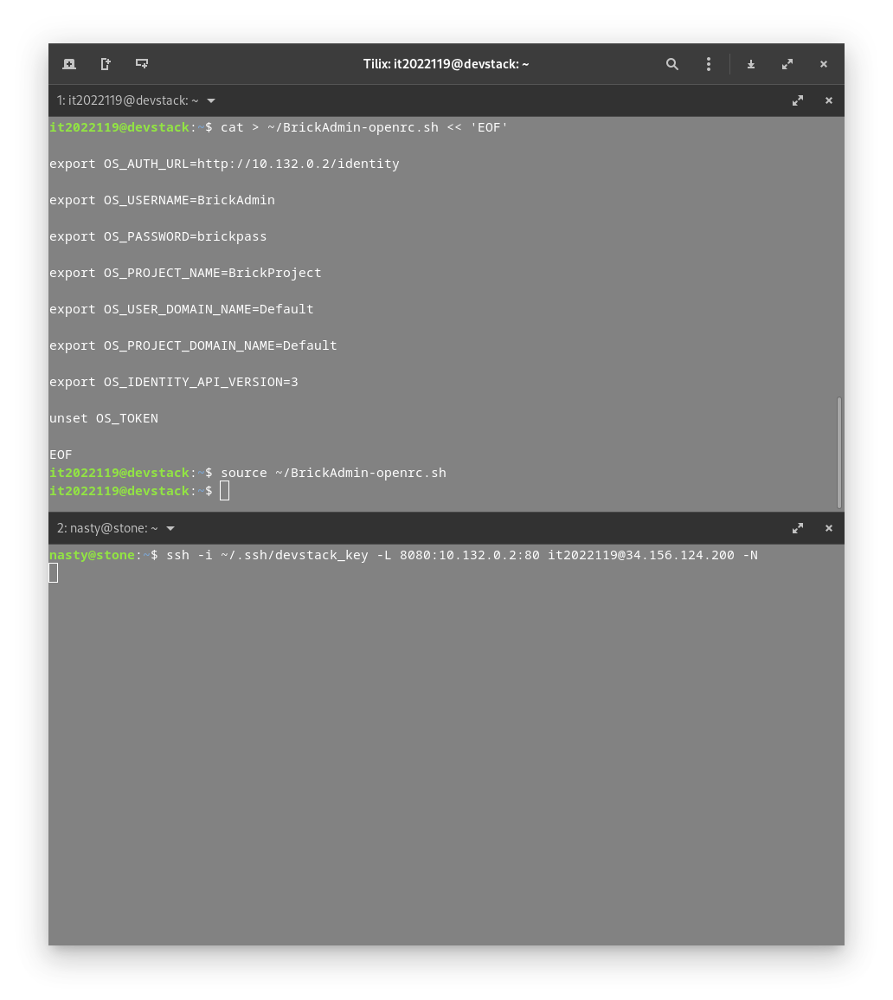

*Εικόνα 65 — Δημιουργία και φόρτωση του αρχείου πιστοποίησης `BrickAdmin-openrc.sh` (OS_USERNAME=BrickAdmin, OS_PROJECT_NAME=BrickProject).*

</div>

> **Σχόλιο:** Το αρχείο αυτό χρησιμοποιείται σε όλη τη συνέχεια της εργασίας — σε επόμενες εικόνες εμφανίζεται η εντολή `source ./BrickAdmin-openrc.sh` ακριβώς για να επιβεβαιωθεί ότι οι πόροι (δίκτυα, VMs, floating IPs) δημιουργούνται με την ταυτότητα του `BrickAdmin` και χρεώνονται στις ποσοστώσεις του `BrickProject`.

<div style="page-break-after: always;"></div>

## Ενότητα 2 — Διαχείριση Quotas

**Στόχος:** Ορισμός των ορίων πόρων (quotas) που μπορεί να καταναλώσει το `BrickProject`, ώστε να μην υπερβαίνει τους διαθέσιμους πόρους της υποδομής.

Τα quotas ορίστηκαν με την εξής εντολή και επαληθεύτηκαν:

```bash
openstack quota set --cores 4 --instances 3 --ram 4096 \
                    --floating-ips 3 --secgroups 4 BrickProject
openstack quota show BrickProject
```

Οι τιμές που τέθηκαν για το project:

| Πόρος | Όριο (quota) |
|---|---|
| Instances | 3 |
| vCPUs (cores) | 4 |
| RAM | 4096 MB |
| Floating IPs | 3 |
| Security Groups | 4 |

<div align="center">

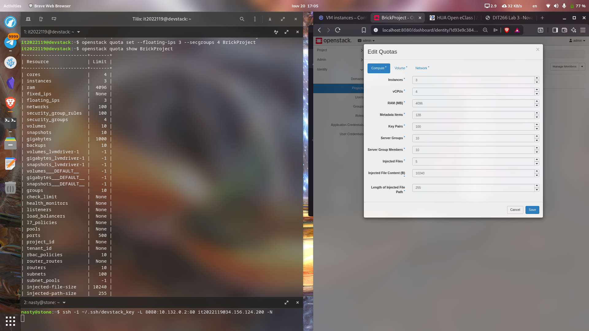

*Εικόνα 22 — Ορισμός quotas για το `BrickProject` (CLI `quota set` / `quota show` και αντίστοιχη οθόνη «Edit Quotas» στο Horizon).*

</div>

> **Τεκμηρίωση επιλογών quotas:** Οι τιμές διαστασιολογήθηκαν με βάση το πραγματικό σενάριο BrickCorp, που απαιτεί **δύο** ταυτόχρονες εικονικές μηχανές (βάση + εφαρμογή). Δόθηκε περιθώριο ασφαλείας **3 instances** ώστε να είναι εφικτή και η δοκιμή τρίτης/εφεδρικής μηχανής χωρίς αλλαγή quota, **4 vCPUs** για να καλύπτονται και τα δύο VMs με περιθώριο, **3 floating IPs** (μία ανά VM + μία εφεδρική) και **4 security groups** για ευελιξία σε μελλοντικό διαχωρισμό κανόνων ανά επίπεδο (web/db). Η RAM ορίστηκε στα 4096 MB, ποσό επαρκές για το άθροισμα `lab.medium` (2048) + `lab.small` (1024) με περιθώριο. Το σύνολο αντικατοπτρίζει τη λογική «πραγματικών» αναγκών του σεναρίου παρά αυθαίρετα όρια.

Για να επιβεβαιωθεί ότι τα όρια εφαρμόστηκαν σωστά **από τη σκοπιά του τελικού χρήστη**, έγινε είσοδος στο Horizon ως `BrickAdmin` και ελέγχθηκε η οθόνη επισκόπησης του project:

<div align="center">

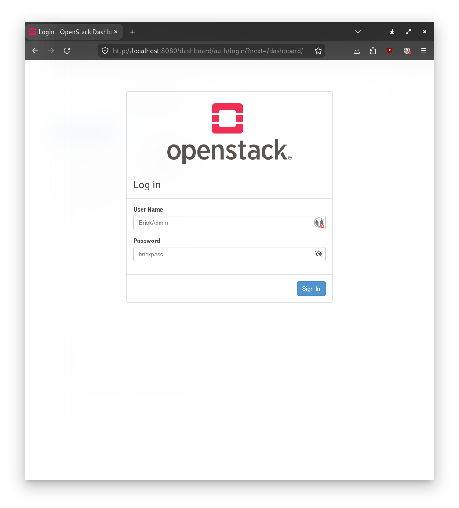

*Εικόνα 23 — Είσοδος στο Horizon με τα credentials του χρήστη `BrickAdmin`.*

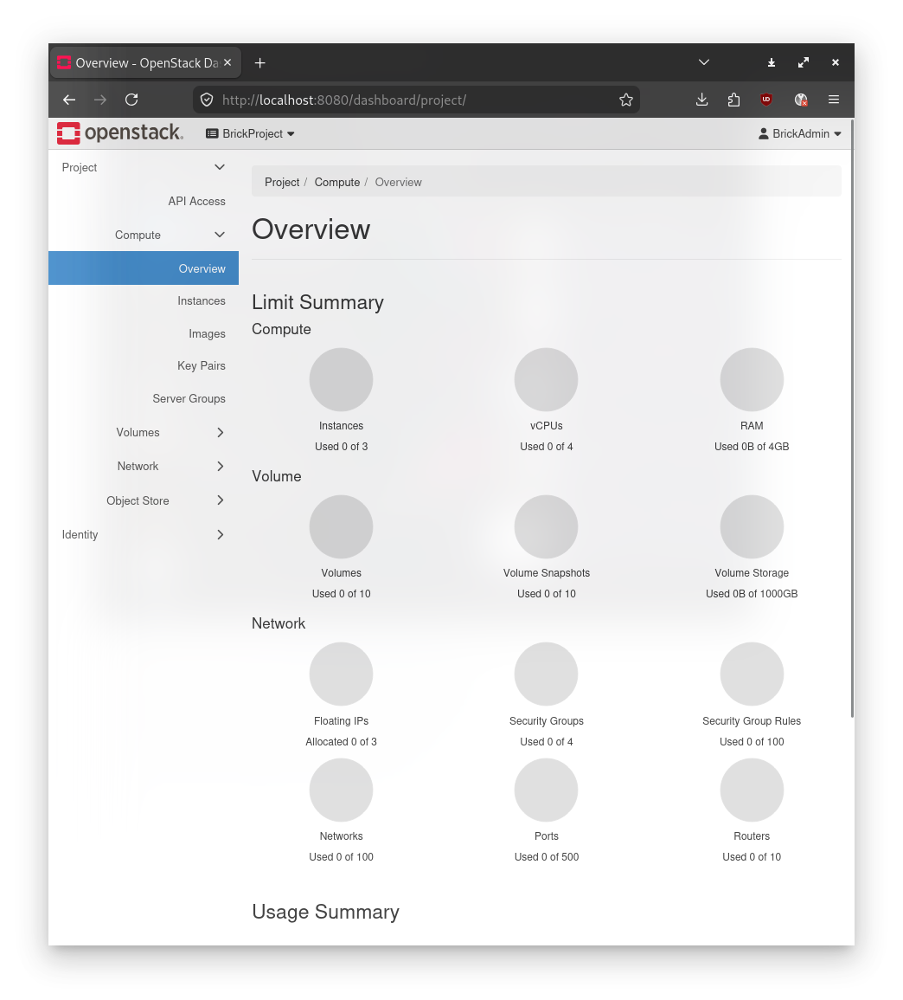

*Εικόνα 24 — Project → Overview ως `BrickAdmin`: το «Limit Summary» επιβεβαιώνει τα όρια (Instances 0/3, vCPUs 0/4, RAM 0/4GB, Floating IPs 0/3, Security Groups 0/4).*

</div>

<div style="page-break-after: always;"></div>

## Ενότητα 3 — Δικτύωση (Network, Subnet, Router)

**Στόχος:** Δημιουργία ιδιωτικού δικτύου για το project, ορισμός υποδικτύου με DHCP/DNS, και σύνδεσή του μέσω δρομολογητή με το εξωτερικό δίκτυο `public` ώστε οι VMs να έχουν εξωτερική συνδεσιμότητα.

### 1 Δημιουργία Δικτύου

```bash
openstack network create --project BrickProject BrickNet
```

Δημιουργήθηκε το δίκτυο `BrickNet` (τύπος `geneve`, `segmentation_id 14576`), που ανήκει στο `BrickProject` (`project_id 1d93e9c3…`).

<div align="center">

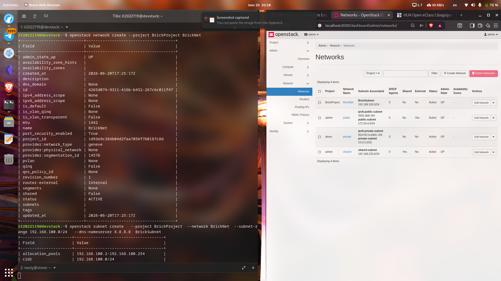

*Εικόνα 25 — Δημιουργία του δικτύου `BrickNet` (CLI) και προβολή στη λίστα δικτύων του Horizon (Admin → Network → Networks).*

</div>

### 2 Δημιουργία Υποδικτύου

Ορίστηκε υποδίκτυο με το ζητούμενο εύρος `192.168.100.0/24`, ενεργό DHCP και DNS server το `8.8.8.8` της Google:

```bash
openstack subnet create --project BrickProject --network BrickNet \
    --subnet-range 192.168.100.0/24 --dns-nameserver 8.8.8.8 BrickSubnet
```

Χαρακτηριστικά: `allocation_pools 192.168.100.2–192.168.100.254`, `gateway_ip 192.168.100.1`, `enable_dhcp True`.

<div align="center">

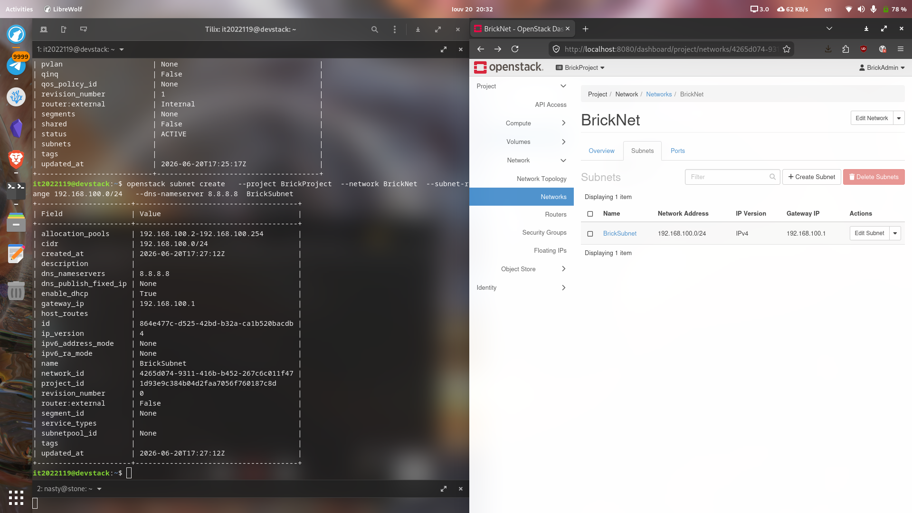

*Εικόνα 26 — Δημιουργία του υποδικτύου `BrickSubnet` (192.168.100.0/24, DNS 8.8.8.8) και προβολή στο Horizon.*

</div>

### 3 Σύνδεση Δρομολογητή

Το `BrickSubnet` συνδέθηκε στον δρομολογητή `BrickRouter` (εσωτερική διεπαφή 192.168.100.1) και κατόπιν ορίστηκε ως πύλη εξόδου το εξωτερικό δίκτυο `public`:

```bash
openstack router add subnet BrickRouter BrickSubnet
openstack router show BrickRouter
openstack router set --external-gateway public BrickRouter
```

Μετά τη ρύθμιση, ο `BrickRouter` απέκτησε εξωτερική διεύθυνση `172.24.4.157` (με `enable_snat: true`), επιτρέποντας στις VMs του `BrickNet` εξερχόμενη πρόσβαση.

<div align="center">

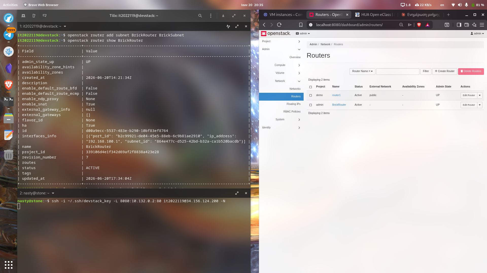

*Εικόνα 27 — Σύνδεση του `BrickSubnet` στον `BrickRouter` (`router add subnet`) και επαλήθευση με `router show`.*

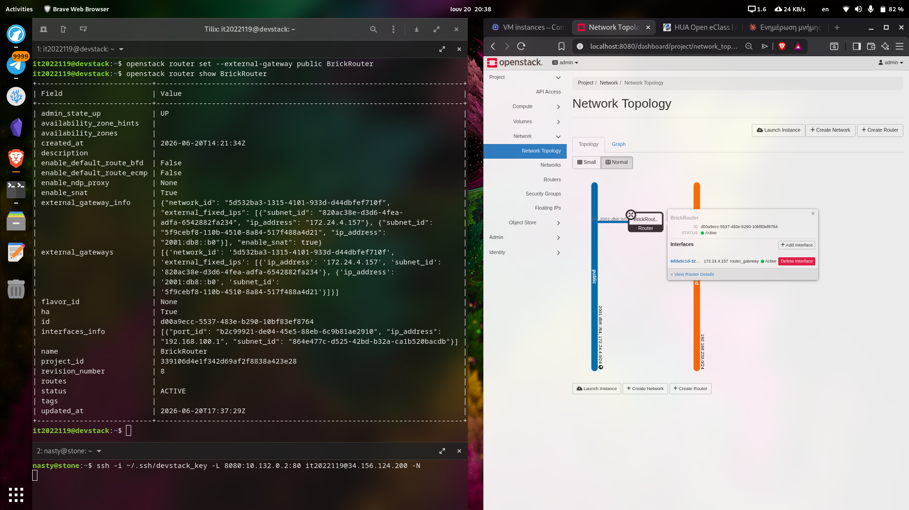

*Εικόνα 28 — Ορισμός εξωτερικής πύλης (`--external-gateway public`). Στο Horizon (Network Topology) ο `BrickRouter` εμφανίζεται να γεφυρώνει το `public` με το ιδιωτικό δίκτυο.*

</div>

> **Σχόλιο:** Το γραφικό «Network Topology» του Horizon αποτυπώνει εποπτικά την τοπολογία και αποτελεί τον πιο γρήγορο τρόπο οπτικής επαλήθευσης ότι ο δρομολογητής συνδέει σωστά εσωτερικό και εξωτερικό δίκτυο.

<div style="page-break-after: always;"></div>

## Ενότητα 4 — Ομάδες Ασφαλείας (Security Groups)

**Στόχος:** Δημιουργία ομάδας ασφαλείας `BrickSG` και προσθήκη κανόνων που επιτρέπουν την απαραίτητη κίνηση προς τις VMs: **SSH (tcp/22)** για απομακρυσμένη διαχείριση, **HTTP (tcp/80)** για την υπηρεσία web, **ICMP** για δοκιμές συνδεσιμότητας (ping), καθώς και **PostgreSQL (tcp/5432)** για την επικοινωνία εφαρμογής–βάσης μεταξύ των δύο VMs.

Δημιουργήθηκε η ομάδα ασφαλείας στο `BrickProject` και προστέθηκαν οι κανόνες εισόδου (ingress):

```bash
openstack security group create --project BrickProject BrickSG

openstack security group rule create --proto tcp  --dst-port 22   BrickSG   # SSH
openstack security group rule create --proto tcp  --dst-port 80   BrickSG   # HTTP
openstack security group rule create --proto icmp                 BrickSG   # ping
openstack security group rule create --proto tcp  --dst-port 5432 BrickSG   # PostgreSQL

openstack security group rule list BrickSG
```

Η `BrickSG` δημιουργήθηκε με `id 4d5b94fa-aeda-4be8-87ad-49bead8f020c` και ανήκει στο `BrickProject` (`project_id 1d93e9c3…`). Οι τελικοί κανόνες (όπως φαίνονται και στο Horizon, «Manage Security Group Rules») είναι:

| Κατεύθυνση | Πρωτόκολλο | Θύρα | Remote | Σκοπός |
|---|---|---|---|---|
| Ingress | TCP | 22 (SSH) | 0.0.0.0/0 | Απομακρυσμένη διαχείριση των VMs |
| Ingress | TCP | 80 (HTTP) | 0.0.0.0/0 | Πρόσβαση στην υπηρεσία web (Nginx) |
| Ingress | ICMP | — | 0.0.0.0/0 | Δοκιμές συνδεσιμότητας (ping) |
| Ingress | TCP | 5432 | 0.0.0.0/0 | Σύνδεση εφαρμογής → PostgreSQL |
| Egress | IPv4 / IPv6 | Any | — | Προεπιλεγμένη εξερχόμενη κίνηση |

<div align="center">

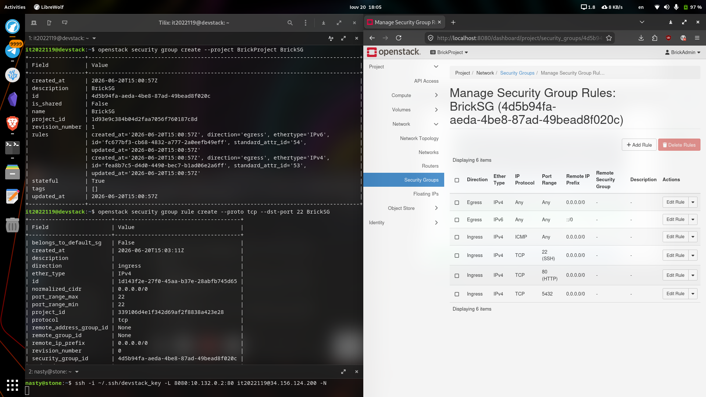

*Εικόνα 64 — Δημιουργία της `BrickSG` και του κανόνα SSH (CLI). Στο Horizon η οθόνη «Manage Security Group Rules: BrickSG» εμφανίζει και τους 6 κανόνες (SSH, HTTP, ICMP, 5432, + egress IPv4/IPv6).*

</div>

> **Σχόλιο:** Ο κανόνας **tcp/5432** προστέθηκε σκόπιμα ώστε το VM της εφαρμογής (`BrickVM-Flask`) να μπορεί να συνδέεται στην PostgreSQL που τρέχει στο `BrickVM-Postgres` — βλ. τη ζωντανή σύνδεση βάσης-εφαρμογής στην Ενότητα 6. Ότι η `BrickSG` εφαρμόστηκε σωστά επιβεβαιώνεται και έμμεσα: χρησιμοποιείται στο `server create` (`--security-group BrickSG`) και τελικά SSH, HTTP, ping και η σύνδεση στη βάση λειτουργούν.

<div style="page-break-after: always;"></div>

## Ενότητα 5 — Key Pairs, Εικονικές Μηχανές & Floating IPs

**Στόχος:** Δημιουργία ζευγών κλειδιών SSH, εκκίνηση των εικονικών μηχανών με τα flavors/εικόνα/δίκτυο/SG που ορίστηκαν, και απόδοση floating IPs για εξωτερική πρόσβαση. Υλοποιήθηκαν **δύο** VMs σύμφωνα με την 2-tier αρχιτεκτονική του σεναρίου.

### VM #1 — `BrickVM-Postgres` (επίπεδο βάσης δεδομένων)

**Δημιουργία ζεύγους κλειδιών** μέσω Horizon (Project → Compute → Key Pairs → Create Key Pair) με όνομα `BrickKey-Postgres`. Το ιδιωτικό κλειδί (`.pem`) κατέβηκε τοπικά για να χρησιμοποιηθεί στις συνδέσεις SSH.

<div align="center">

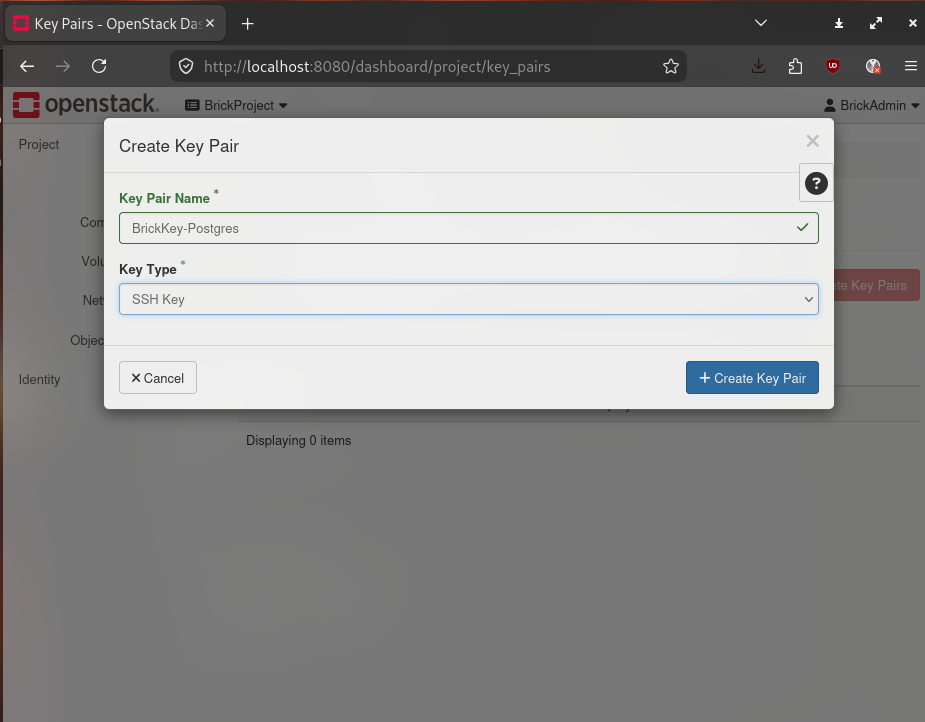

*Εικόνα 29 — Δημιουργία του key pair `BrickKey-Postgres` από το Horizon.*

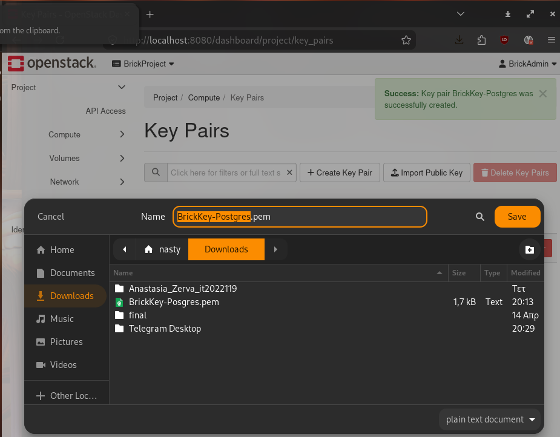

*Εικόνα 30 — Αποθήκευση του ιδιωτικού κλειδιού `BrickKey-Postgres.pem` (επιτυχής δημιουργία).*

</div>

**Εκκίνηση της εικονικής μηχανής** με `lab.medium`, εικόνα `debian-12-cloud`, δίκτυο `BrickNet`, ομάδα ασφαλείας `BrickSG` και το παραπάνω κλειδί:

```bash
openstack server create --flavor lab.medium --image "debian-12-cloud" \
    --network BrickNet --security-group BrickSG \
    --key-name BrickKey-Postgres BrickVM-Postgres
```

Η VM δημιουργήθηκε με `id 5f485769…` και εσωτερική IP **192.168.100.208**.

<div align="center">

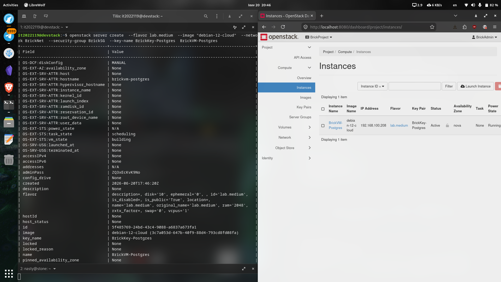

*Εικόνα 31 — Δημιουργία της `BrickVM-Postgres` (CLI) και εμφάνισή της ως Active/Running στο Horizon (Instances).*

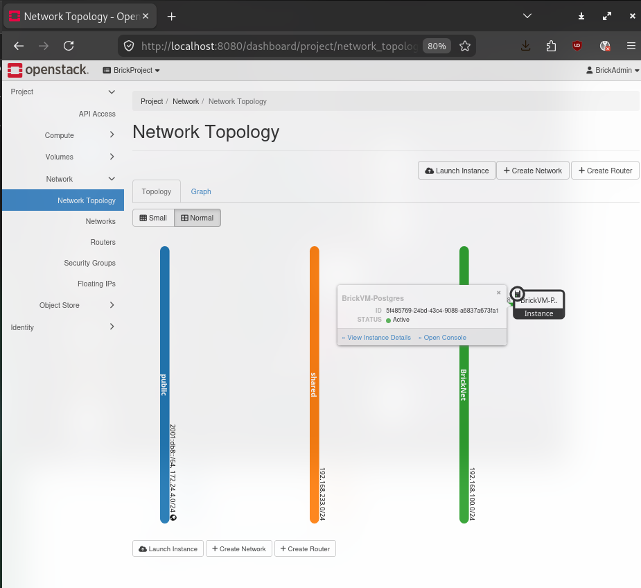

*Εικόνα 32 — Η `BrickVM-Postgres` συνδεδεμένη στο `BrickNet` στο Network Topology.*

</div>

**Απόδοση Floating IP:** δεσμεύτηκε διεύθυνση από το `public` και αντιστοιχίστηκε στη VM:

```bash
openstack floating ip create public            # -> 172.24.4.110
openstack floating ip list
openstack server add floating ip BrickVM-Postgres 172.24.4.110
```

<div align="center">

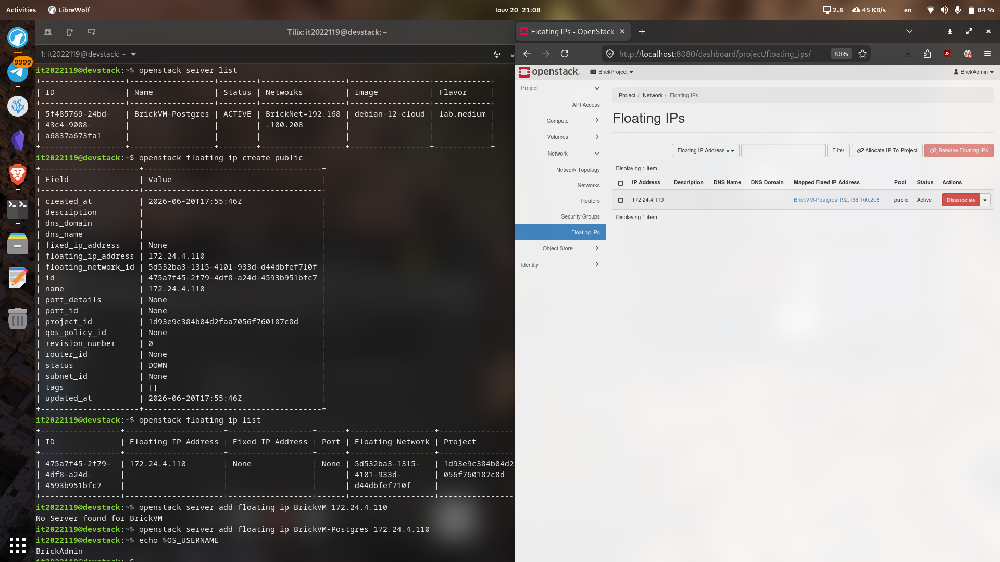

*Εικόνα 33 — Δημιουργία floating IP `172.24.4.110` και αντιστοίχισή της στην `BrickVM-Postgres` (CLI και Horizon → Floating IPs).*

</div>

### 7.2 VM #2 — `BrickVM-Flask` (επίπεδο εφαρμογής)

Με ανάλογη διαδικασία δημιουργήθηκε δεύτερο ζεύγος κλειδιών `BrickKey-Flask` και η δεύτερη μηχανή με `lab.small`:

```bash
openstack server create --flavor lab.small --image "debian-12-cloud" \
    --network BrickNet --security-group BrickSG \
    --key-name BrickKey-Flask BrickVM-Flask
```

Η `BrickVM-Flask` έλαβε εσωτερική IP **192.168.100.123**.

<div align="center">

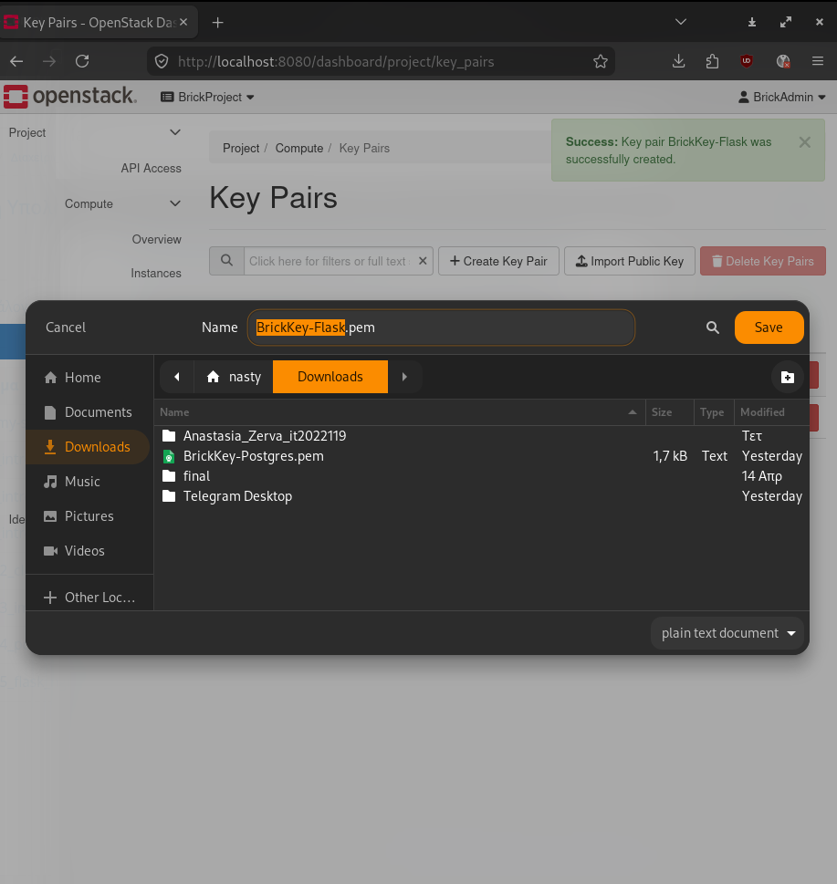

*Εικόνα 44 — Αποθήκευση του κλειδιού `BrickKey-Flask.pem`.*

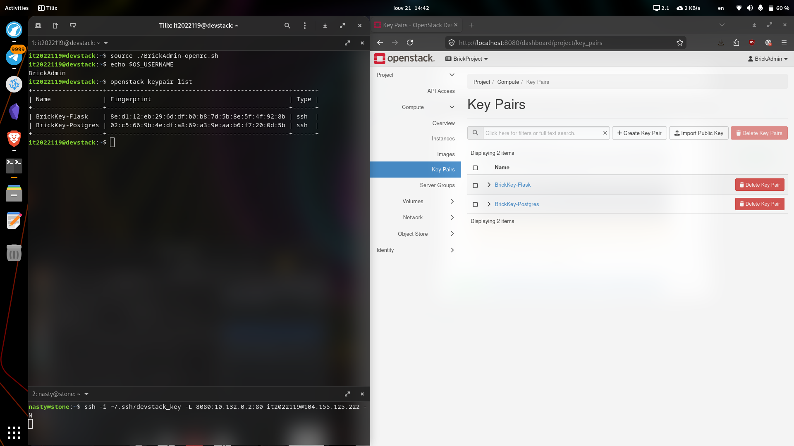

*Εικόνα 45 — `openstack keypair list`: και τα δύο ζεύγη (`BrickKey-Flask`, `BrickKey-Postgres`) — επιβεβαίωση και στο Horizon.*

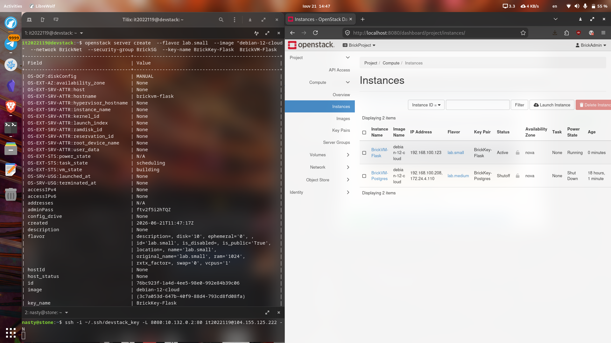

*Εικόνα 46 — Δημιουργία της `BrickVM-Flask` (lab.small). Στο Horizon εμφανίζονται πλέον δύο instances.*

</div>

**Απόδοση δεύτερης Floating IP** στη `BrickVM-Flask`:

```bash
openstack floating ip create public            # -> 172.24.4.50
openstack server add floating ip BrickVM-Flask 172.24.4.50
```

<div align="center">

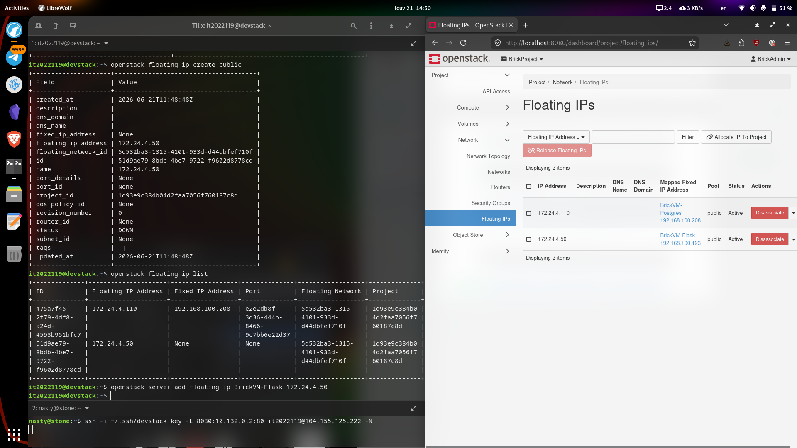

*Εικόνα 47 — Δημιουργία floating IP `172.24.4.50` και αντιστοίχιση στη `BrickVM-Flask` (δύο floating IPs ενεργές στο Horizon).*

</div>

> **Σχόλιο:** Η χρήση **δύο VMs με διαφορετικά flavors** και **ξεχωριστά ζεύγη κλειδιών** δεν είναι τυχαία: υλοποιεί την αρχή του διαχωρισμού επιπέδων (separation of concerns) — η βάση δεδομένων και η εφαρμογή τρέχουν σε ανεξάρτητες μηχανές, με ανεξάρτητη πρόσβαση. Αυτό αξιοποιεί ακριβώς το περιθώριο που δόθηκε στις ποσοστώσεις της Ενότητας 2.

<div style="page-break-after: always;"></div>

## Ενότητα 6 — Επαλήθευση, Δοκιμές & Σενάριο Χρήσης

**Στόχος:** Επαλήθευση ότι η υποδομή λειτουργεί end-to-end, με πραγματικό φόρτο. Πέρα από τους βασικούς ελέγχους συνδεσιμότητας, αναπτύχθηκε ένα **ολοκληρωμένο 2-tier σενάριο BrickCorp**: μια βάση PostgreSQL στο πρώτο VM και μια εφαρμογή Flask στο δεύτερο που διαβάζει δεδομένα από τη βάση.

### 1 Έλεγχος Δικτύωσης & Συνδεσιμότητας

Επιβεβαιώθηκε η δρομολόγηση του host (`br-ex`, route προς `172.24.4.0/24`) και η προσβασιμότητα της floating IP της πρώτης VM με `ping`:

```bash
source /opt/stack/devstack/openrc admin admin
sudo ip link set br-ex up
ip route show
ping -c 3 172.24.4.110     # 0% packet loss
```

<div align="center">

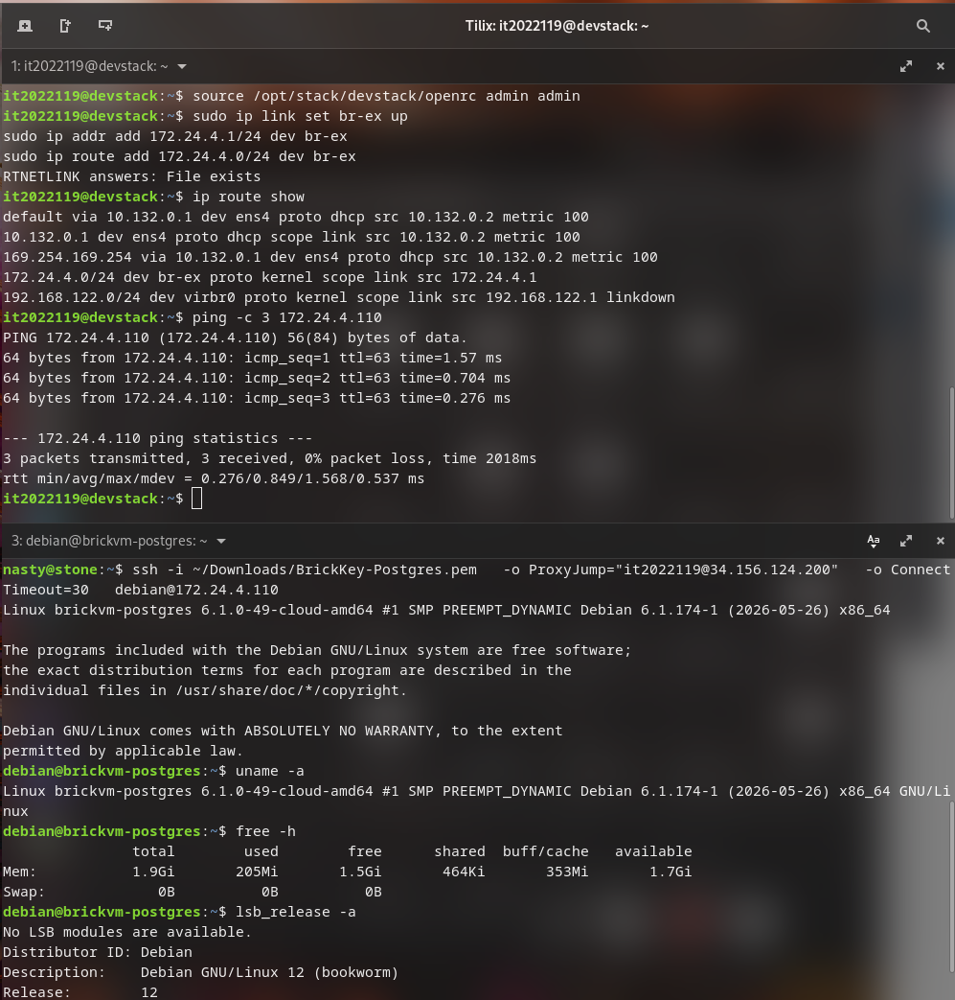

*Εικόνα 34 — Έλεγχος δρομολόγησης host και επιτυχές `ping` (3/3) προς την floating IP `172.24.4.110`.*

</div>

Για να είναι μόνιμη η ρύθμιση του `br-ex` μετά από reboot, δημιουργήθηκε ειδικό **systemd service** (`brex-setup.service`):

<div align="center">

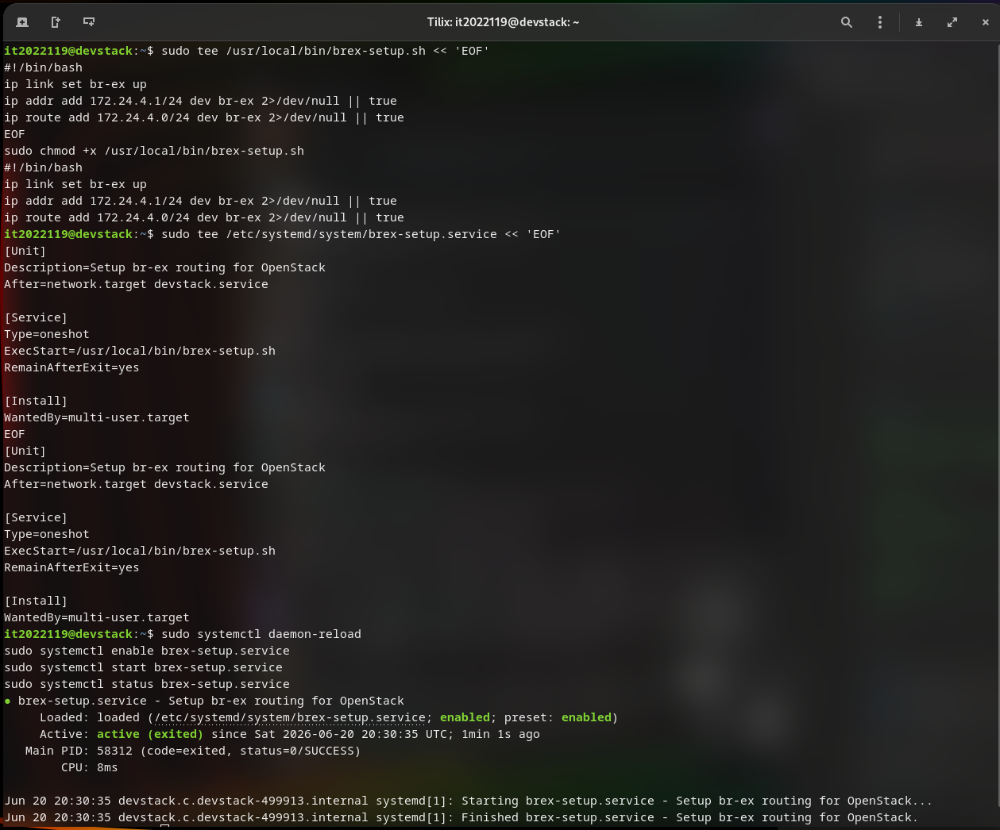

*Εικόνα 42 — Δημιουργία/ενεργοποίηση του `brex-setup.service` για μόνιμη ρύθμιση της δρομολόγησης `br-ex`.*

</div>

**Σύνδεση SSH** στην `BrickVM-Postgres` μέσω `ProxyJump` (η VM είναι εσωτερική, οπότε η σύνδεση δρομολογείται μέσω της GCP VM) και βασικοί έλεγχοι λειτουργικού:

```bash
ssh -i ~/Downloads/BrickKey-Postgres.pem \
    -o ProxyJump="<user>@<EXTERNAL_IP>" debian@172.24.4.110
uname -a ; free -h ; lsb_release -a
```

<div align="center">

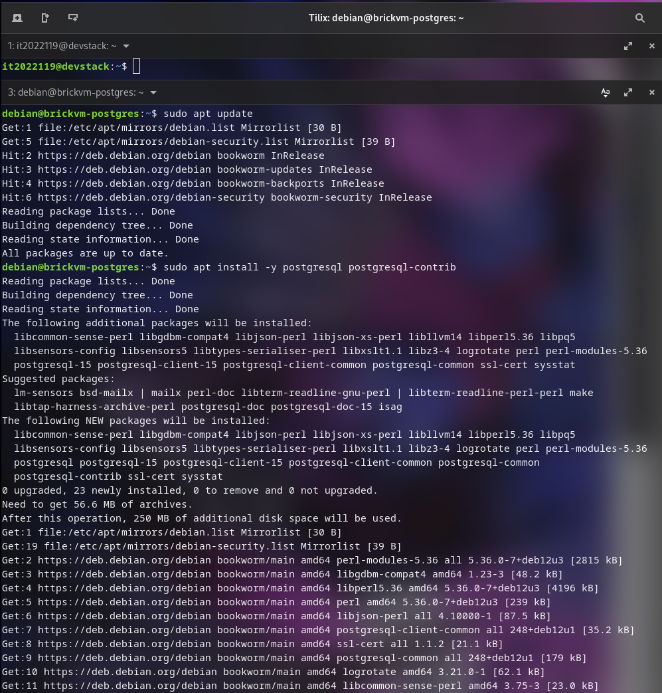

*Εικόνα 35 — Επιτυχής SSH είσοδος στην `BrickVM-Postgres` (Debian 12) και έλεγχοι `uname`/`free`/`lsb_release`.*

</div>

### 2 Επίπεδο Βάσης — Εγκατάσταση & Ρύθμιση PostgreSQL

Στην `BrickVM-Postgres` εγκαταστάθηκε ο PostgreSQL server:

```bash
sudo apt update
sudo apt install -y postgresql postgresql-contrib
psql --version
sudo systemctl enable --now postgresql
```

<div align="center">

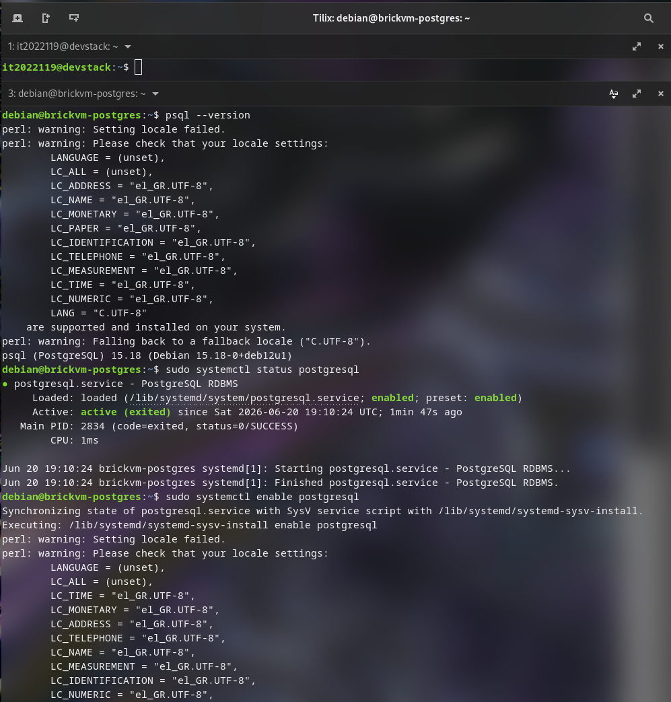

*Εικόνα 36 — Εγκατάσταση PostgreSQL 15 και ενεργοποίηση της υπηρεσίας (`systemctl enable`).*

</div>

Δημιουργήθηκαν χρήστης εφαρμογής, βάση και ο πίνακας δεδομένων `products`:

```sql
CREATE USER appuser WITH PASSWORD 'apppassword123';
CREATE DATABASE BrickCorp OWNER appuser;
GRANT ALL PRIVILEGES ON DATABASE BrickCorp TO appuser;

CREATE TABLE products (
    id SERIAL PRIMARY KEY,
    name VARCHAR(100) NOT NULL,
    description TEXT,
    price NUMERIC(10,2),
    created_at TIMESTAMP DEFAULT NOW()
);
INSERT INTO products (name, description, price) VALUES
  ('Laptop Pro','High-performance laptop',1299.99),
  ('Wireless Mouse','Ergonomic wireless mouse',29.99),
  ('USB Hub','7-port USB 3.0 hub',49.99),
  ('Monitor 4K','27-inch 4K display',599.99);
```

<div align="center">

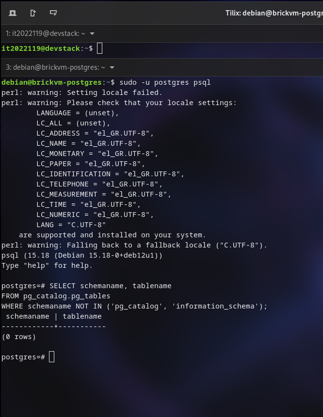

*Εικόνα 37 — Είσοδος στην PostgreSQL (`sudo -u postgres psql`).*

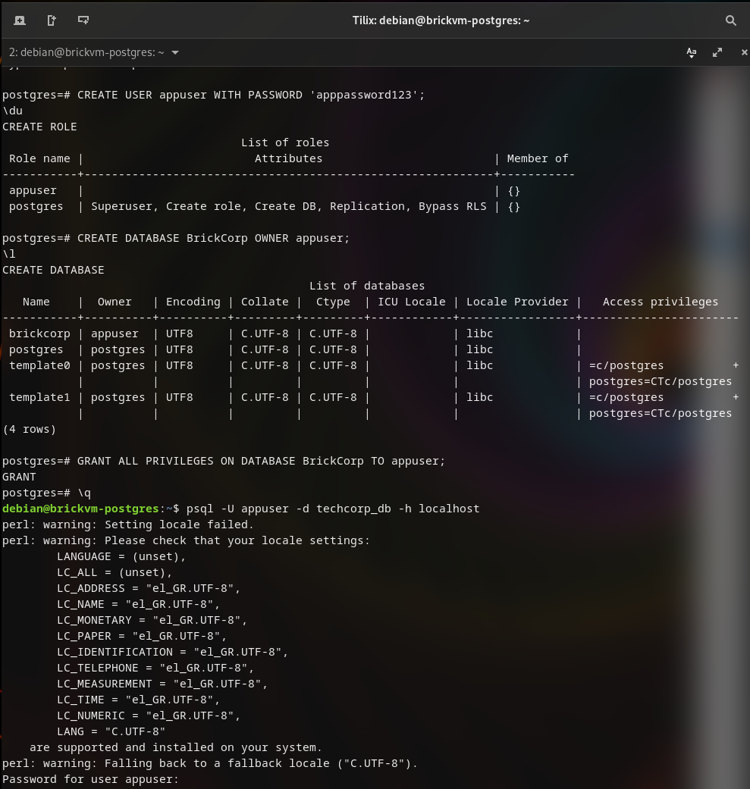

*Εικόνα 38 — Δημιουργία χρήστη `appuser`, βάσης `brickcorp` και απόδοση δικαιωμάτων.*

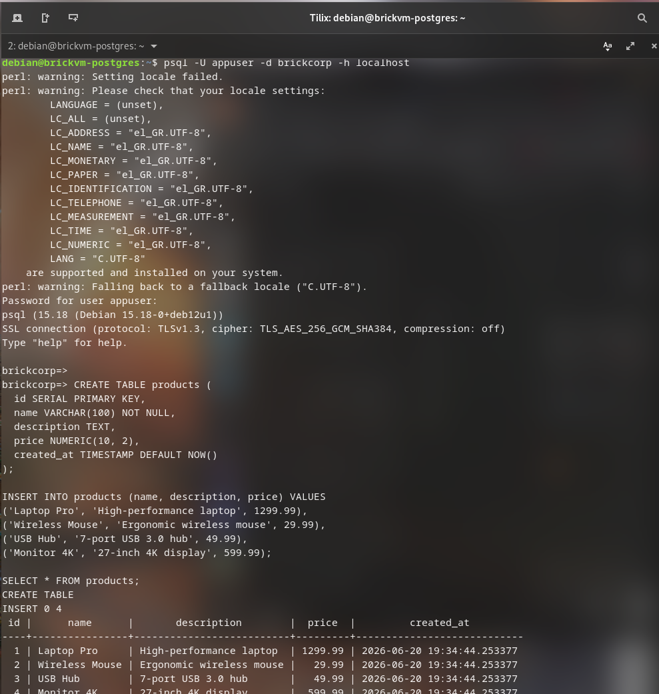

*Εικόνα 39 — Δημιουργία πίνακα `products` και εισαγωγή εγγραφών.*

</div>

Στη συνέχεια η PostgreSQL ρυθμίστηκε ώστε να δέχεται **απομακρυσμένες συνδέσεις** (`listen_addresses='*'`, κανόνας στο `pg_hba.conf`), για να μπορεί να τη χρησιμοποιεί το VM της εφαρμογής:

```bash
sudo sed -i "s/#listen_addresses = 'localhost'/listen_addresses = '*'/" \
    /etc/postgresql/*/main/postgresql.conf
echo "host all all 0.0.0.0/0 md5" | sudo tee -a /etc/postgresql/*/main/pg_hba.conf
sudo systemctl restart postgresql
```

Επαληθεύτηκε ότι η βάση είναι προσβάσιμη **απομακρυσμένα** (από τον host DevStack και αργότερα από το άλλο VM):

<div align="center">

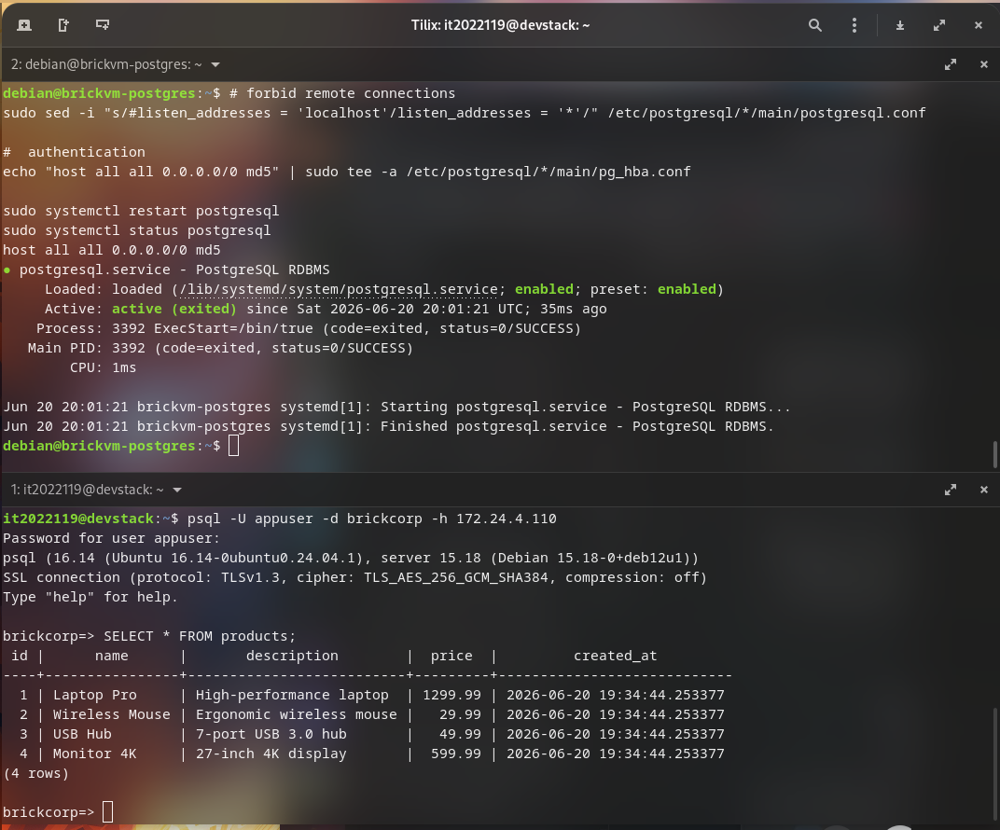

*Εικόνα 40 — Ρύθμιση απομακρυσμένων συνδέσεων (`pg_hba.conf`) και επιτυχής σύνδεση από απόσταση με `psql -U appuser -d brickcorp -h …`.*

</div>

### 3 Snapshots (OpenStack & GCP)

Για λόγους αντιγράφων ασφαλείας/επαναχρησιμοποίησης, δημιουργήθηκε **snapshot εικόνας** της VM στο OpenStack (Glance) και **snapshot δίσκου** της υποκείμενης GCP VM:

```bash
openstack server image create --name "BrickVM-Postgres-snapshot" BrickVM-Postgres
openstack image list
```

<div align="center">

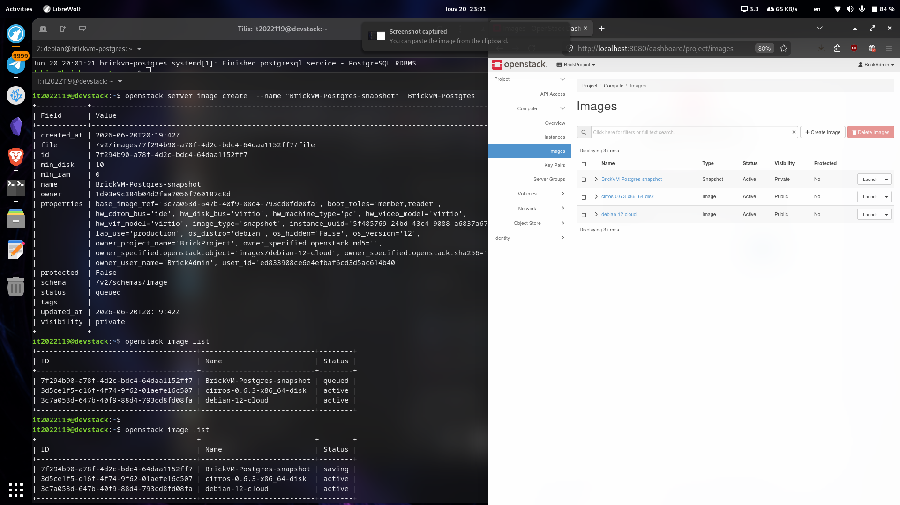

*Εικόνα 41 — Δημιουργία snapshot `BrickVM-Postgres-snapshot` (Glance image) — εμφανίζεται στο Horizon → Images.*

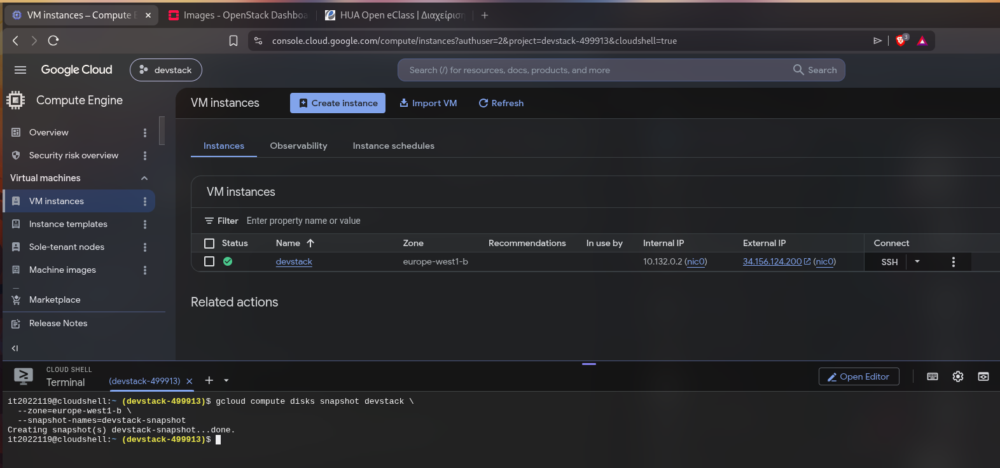

*Εικόνα 43 — Snapshot του δίσκου της GCP VM μέσω Google Cloud Shell (`gcloud compute disks snapshot`).*

</div>

### 4 Επίπεδο Εφαρμογής — Flask REST API

Στη `BrickVM-Flask` (σύνδεση SSH με το `BrickKey-Flask.pem`) εγκαταστάθηκαν τα εργαλεία Python και δημιουργήθηκε virtual environment με Flask/psycopg2/gunicorn:

```bash
ssh -i ~/Downloads/BrickKey-Flask.pem -o ProxyJump="<user>@<EXTERNAL_IP>" debian@172.24.4.50
sudo apt install -y python3-pip python3-venv python3-dev libpq-dev
mkdir ~/BrickCorp-app && cd ~/BrickCorp-app
python3 -m venv venv && source venv/bin/activate
pip install flask psycopg2-binary gunicorn
```

<div align="center">

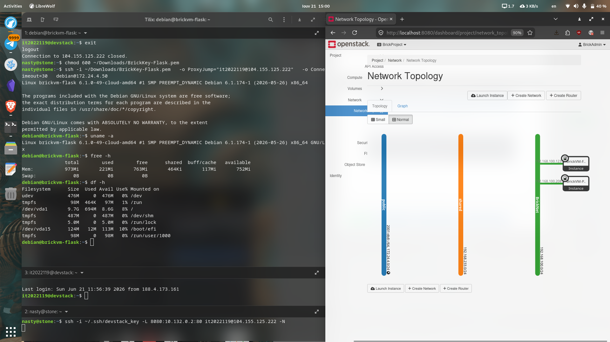

*Εικόνα 48 — SSH στην `BrickVM-Flask` και βασικοί έλεγχοι (`uname`/`free`/`df`). Στο Network Topology εμφανίζονται και τα δύο instances στο `BrickNet`.*

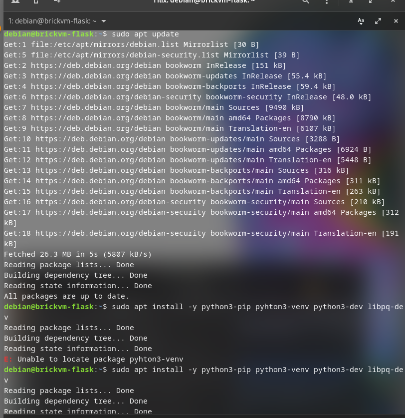

*Εικόνα 50 — Εγκατάσταση `python3-pip`, `python3-venv`, `python3-dev`, `libpq-dev`.*


*Εικόνα 51 — Δημιουργία `BrickCorp-app`, virtualenv και `pip install flask psycopg2-binary gunicorn`.*


*Εικόνα 52 — Επιτυχής εγκατάσταση των πακέτων.*

</div>

Γράφτηκε η εφαρμογή `app.py`, η οποία συνδέεται στην **απομακρυσμένη** PostgreSQL του πρώτου VM (`host 192.168.100.208`, βάση `brickcorp`) και εκθέτει REST endpoints:

<div align="center">


*Εικόνα 53 — Ο κώδικας `app.py`: σύνδεση με `psycopg2` στη βάση `brickcorp` (192.168.100.208) και ανάγνωση του πίνακα `products`.*

</div>

### 5 Λειτουργική Δοκιμή (development server)

Πριν τη δοκιμή, βεβαιώθηκε ότι **και οι δύο** μηχανές είναι ενεργές:

```bash
openstack server start BrickVM-Postgres
openstack server list   # BrickVM-Flask & BrickVM-Postgres -> ACTIVE
```

<div align="center">


*Εικόνα 49 — `server list`: και τα δύο instances ACTIVE, με εσωτερικές + floating IPs (Horizon σε συμφωνία).*

</div>

Σε πρώτη φάση η εφαρμογή Flask εκτελέστηκε με τον ενσωματωμένο development server και δοκιμάστηκε με `curl`. Το endpoint `/api/products` επιστρέφει σε JSON τα δεδομένα που είχαν εισαχθεί στην PostgreSQL του **άλλου** VM — αποδεικνύοντας ότι ολόκληρη η αλυσίδα (δίκτυο → security group → δύο VMs → βάση → εφαρμογή) λειτουργεί:

```bash
python app.py
curl http://127.0.0.1:5000/health      # {"status": "ok"}
curl http://127.0.0.1:5000/api/products
```

<div align="center">


*Εικόνα 54 — Η εφαρμογή Flask τρέχει (development server)· το `curl /api/products` επιστρέφει τα προϊόντα από τη βάση του `BrickVM-Postgres`.*

</div>

### 6 Παραγωγική Ανάπτυξη — Gunicorn (systemd) + Nginx

Επειδή ο development server του Flask δεν είναι κατάλληλος για παραγωγή, η εφαρμογή «τυλίχθηκε» σε μια κανονική στοίβα παραγωγής: **Gunicorn** ως WSGI application server, διαχειριζόμενο από **systemd**, και **Nginx** ως reverse proxy μπροστά του.

**Βήμα 1 — Gunicorn ως systemd service.** Δημιουργήθηκε το `brickcorp.service` που τρέχει το Gunicorn με 2 workers, δεμένο στο `127.0.0.1:5000`, με αυτόματη επανεκκίνηση:

```ini
[Unit]
Description=BrickCorp Flask App (Gunicorn)
After=network.target postgresql.service

[Service]
User=debian
WorkingDirectory=/home/debian/BrickCorp-app
Environment="PATH=/home/debian/BrickCorp-app/venv/bin"
ExecStart=/home/debian/BrickCorp-app/venv/bin/gunicorn --workers 2 --bind 127.0.0.1:5000 app:app
Restart=always
RestartSec=3

[Install]
WantedBy=multi-user.target
```

```bash
sudo systemctl daemon-reload
sudo systemctl enable brickcorp
sudo systemctl start brickcorp
sudo systemctl status brickcorp   # active (running)
```

<div align="center">


*Εικόνα 55 — Δημιουργία και ενεργοποίηση του `brickcorp.service` (Gunicorn, 2 workers) — κατάσταση active (running).*


*Εικόνα 56 — Έλεγχος των logs της υπηρεσίας με `journalctl -u brickcorp -f` (εκκίνηση Gunicorn workers).*

</div>

**Βήμα 2 — Nginx ως reverse proxy.** Εγκαταστάθηκε ο Nginx και ρυθμίστηκε να προωθεί την κίνηση της θύρας 80 στο Gunicorn (`proxy_pass http://127.0.0.1:5000`):

```bash
sudo apt install -y nginx
```

```nginx
server {
    listen 80;
    server_name _;
    location / {
        proxy_pass http://127.0.0.1:5000;
        proxy_set_header Host $host;
        proxy_set_header X-Real-IP $remote_addr;
        proxy_set_header X-Forwarded-For $proxy_add_x_forwarded_for;
    }
    location /health {
        proxy_pass http://127.0.0.1:5000/health;
    }
}
```

```bash
sudo ln -s /etc/nginx/sites-available/brickcorp /etc/nginx/sites-enabled/
sudo rm -f /etc/nginx/sites-enabled/default
sudo nginx -t            # syntax is ok / test is successful
sudo systemctl restart nginx
```

<div align="center">


*Εικόνα 57 — Εγκατάσταση του Nginx (`apt install -y nginx`).*


*Εικόνα 58 — Η υπηρεσία `nginx.service` σε κατάσταση active (running).*


*Εικόνα 59 — Ρύθμιση του Nginx ως reverse proxy (`sites-available/brickcorp`), έλεγχος `nginx -t` επιτυχής και επανεκκίνηση.*

</div>

> **Σχόλιο αρχιτεκτονικής:** Η ροή αιτήματος είναι πλέον **Nginx (port 80) → Gunicorn (127.0.0.1:5000) → Flask → PostgreSQL (192.168.100.208)**. Είναι η τυπική παραγωγική τοπολογία μιας web εφαρμογής Python, και αξιοποιεί τον κανόνα **tcp/80** της ομάδας ασφαλείας `BrickSG`.

### 7 Τελική Επαλήθευση End-to-End (μέσω browser)

Με τον Nginx ενεργό, η εφαρμογή είναι προσβάσιμη στη θύρα 80 της VM. Μέσω SSH tunnel (`-L 8888:172.24.4.50:80`) η σελίδα ανοίχτηκε σε τοπικό browser και εμφανίζει τον **κατάλογο προϊόντων** που διαβάζεται ζωντανά από την PostgreSQL του γειτονικού VM:

<div align="center">


*Εικόνα 60 — Η ιστοσελίδα «Product Catalog» στον browser (μέσω Nginx/port 80) και επιτυχή `curl http://localhost/health` & `/api/products`.*

</div>

Για να αποδειχθεί ότι τα δεδομένα είναι **δυναμικά** (και όχι στατικά), προστέθηκε μια νέα εγγραφή απευθείας στη βάση του `BrickVM-Postgres` και η αλλαγή εμφανίστηκε άμεσα στη σελίδα (από 4 σε 5 προϊόντα):

```sql
INSERT INTO products (name, description, price)
VALUES ('Cloud Storage', 'Secure cloud backup solution', 9.99);
```

<div align="center">


*Εικόνα 61 — Μετά την εισαγωγή της εγγραφής «Cloud Storage» στη βάση (VM #1), η σελίδα της εφαρμογής (VM #2) εμφανίζει 5 προϊόντα — επιβεβαίωση της ζωντανής σύνδεσης βάσης-εφαρμογής μεταξύ των δύο VMs.*


*Εικόνα 62 — Τα αιτήματα καταγράφονται στο `access.log` του Nginx (GET /, /health, /api/products με κωδικούς 200).*

</div>

**Δεύτερο snapshot.** Τέλος, δημιουργήθηκε snapshot και της δεύτερης VM, ώστε να υπάρχει αντίγραφο ολόκληρης της στοίβας εφαρμογής:

```bash
openstack server image create --name "BrickVM-Flask-snapshot" BrickVM-Flask
openstack image list
```

<div align="center">


*Εικόνα 63 — Δημιουργία του `BrickVM-Flask-snapshot`. Στο Horizon → Images εμφανίζονται και τα δύο snapshots (`BrickVM-Flask-snapshot` 1.92 GB, `BrickVM-Postgres-snapshot` 1.63 GB), ιδιοκτησίας `BrickProject`.*

</div>

<div style="page-break-after: always;"></div>

